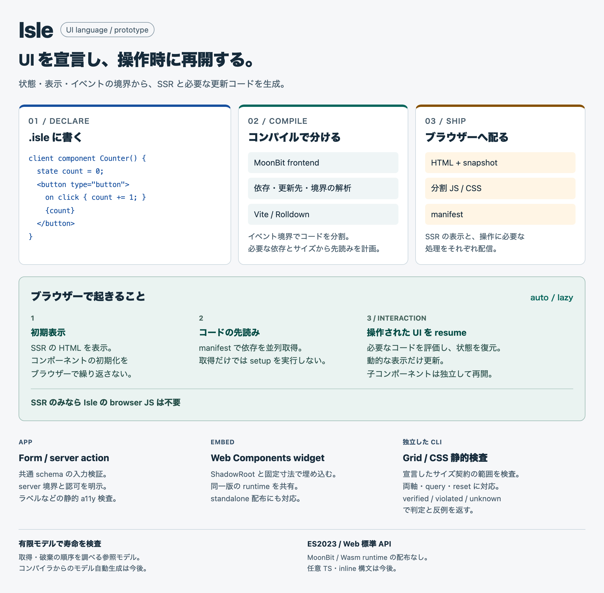

# Isle

[English](README.md) · 日本語

[ドキュメント・ライブデモ](https://mizchi.github.io/isle/ja/)

SSR するアプリと、外部サイトへ埋め込む Web Components を、操作時に再開する UI として作れます。`.isle` に状態・表示・イベントの境界を書くと、コンパイラが更新先を絞った DOM コードを生成し、Vite / Rolldown が配信コードを分割します。

<picture>
  <source media="(max-width: 760px)" srcset="docs/overview/figures/isle-overview.mobile.png">
  
</picture>

初期表示はサーバーの HTML を使い、コンポーネントの初期化をブラウザーで繰り返しません。既定の `auto` ではコードを先読みできますが、状態の復元・resource setup・handler は操作まで遅延します。子コンポーネントは独立して再開し、SSR 専用ページには Isle の browser JS を出力しません。

## はじめる

Node.js 24+ と Vite 8 系（8.3.5 以上）を使います。コンパイル済み frontend をパッケージに含めるため、アプリの利用者は MoonBit・Z3・コンパイラの checkout を用意する必要はありません。

**プレビュー配布:** パッケージは現在 private です。[プレビュー版の npm アーカイブ](artifacts/isle-prototype-0.0.1.tgz)をダウンロードし、自分のアプリへインストールします。レジストリ公開は別の工程として扱います。パッケージ名と import パスは `@isle/prototype` です。

```sh
pnpm add ./isle-prototype-0.0.1.tgz
pnpm add -D vite@^8.3.5
```

レジストリ公開後は、最初のコマンドを `pnpm add @isle/prototype` に置き換えます。自分のアプリに次の3ファイルを作ります。

### `app.isle`

<!-- file: app.isle -->
```text
client component Counter(initial: number) {
  state count = initial;
  derive doubled = count * 2;
  <section>
    <h2>Counter</h2>
    <output aria-live="polite">{count} / {doubled}</output>
    <button type="button">on click increment { count += 1; }Increment</button>
    <button type="button">on click reset { count = initial; }Reset</button>
  </section>
}
```

### `index.html`

<!-- file: index.html -->
```html
<!doctype html>
<html lang="en">
<head>
  <meta charset="utf-8">
  <meta name="viewport" content="width=device-width, initial-scale=1">
  <title>My Isle app</title>
  <style>
    body { max-width: 640px; margin: 32px auto; padding: 0 16px; font: 18px/1.6 system-ui; }
    button { display: block; min-height: 44px; margin: 8px 0; padding: 8px 16px; font: inherit; }
  </style>
</head>
<body>
  <h1>My Isle app</h1>
  <!--isle:ssr-->
</body>
</html>
```

### `vite.config.mjs`

<!-- file: vite.config.mjs -->
```js
import { defineConfig } from 'vite';
import { fileURLToPath } from 'node:url';
import { isle } from '@isle/prototype/vite';

export default defineConfig({
  plugins: [isle({
    entry: fileURLToPath(new URL('./app.isle', import.meta.url)),
    mounts: [{ component: 'Counter', props: { initial: 5 }, label: 'Counter' }],
  })],
  build: { target: 'es2023' },
});
```

`pnpm exec vite` を実行し、表示された URL を開きます。Counter は `5 / 10` から始まり、Increment で `6 / 12`、Reset で初期値に戻ります。`pnpm exec vite build` でビルドし、`dist/` の出力を確認・配信できます。

この例にブラウザー entry の記述は不要です。`<!--isle:ssr-->` が SSR の HTML の挿入位置で、plugin が操作に必要な loader と chunk も生成します。

このビルドは初期 HTML をビルド時に生成します。リクエスト時の server action には server adapter が必要で、この設定だけで一般のリクエスト時ページレンダラーが構成されるわけではありません。`.isle` の制約付き宣言以外のロジックは、通常の JavaScript の setup / host module に書けます。

## 試せる機能

| 試す機能 | 操作と確認 |
| --- | --- |
| [TodoMVC](examples/todomvc/) | Todo の追加・編集・絞り込み・保存と、Qwik・Preact との production サイズ比較。 |
| [最小の Counter](examples/hello/) | SSR した値を増やし、初期値へ戻す。 |
| [ブラウザー JS のない SSR](examples/ssr-only/) | ビルドに Isle runtime・snapshot・handler chunk が含まれないことを確認する。 |
| [動的な表示だけ更新](examples/partial-updates/) | 一つの値を変更し、静的見出しと無関係な出力の DOM が保持されることを確かめる。 |
| [入れ子と children](examples/composition/) | 親と子を独立に再開し、純粋 component の children を表示する。 |
| [分岐・key 付きリスト・例外](examples/control-flow/) | 分岐を切り替え、key 付き行を並べ替え、空配列で @empty と同期 @catch を確認する。 |
| [manifest による読み込み](examples/loading/) | manifest の先読み判断を調べ、入力時には Search だけが活性化することを確認する。 |
| [リソースの寿命と破棄](examples/resources/) | 所有された timer と listener を活性化し、component を削除して一度だけ破棄されることを見る。 |
| [遅延 CSS と準備完了](examples/styles/) | setup module と CSS を読み込み、setup から見える適用済み style を調べる。 |
| [標準の遷移先読み](examples/navigation/) | Speculation Rules の data block と通常リンクを確認する。Isle の browser JS は出力しない。 |
| [標準フォームの検証](examples/form/) | 不正入力・必須同意・送信成功を、ラベル付きのフォームで試す。 |
| [共通 schema とサーバー検証](examples/schema-form/) | taken@example.com の重複エラーを確認し、修正・送信・reset を試す。 |
| [明示的な server action](examples/counter/) | 独立した Counter と、検証・認可を経由する文書名変更を試す。 |
| [CSS 契約の3つの結果](examples/layout-contracts/) | reset を考慮した Grid 契約で verified・overflow の violated・未対応の unknown を試す。 |
| [ポータブルな Web Components](examples/portable-widget/) | 複数 widget をマウントし、共有版・standalone 版・版の不一致の拒否を確認する。 |
| [Workers からの widget 配信](examples/worker-widget/) | widget-dev と widget-host を別 terminal で起動し、別 origin に固定サイズの Shadow DOM widget を埋め込む。 |

[サンプル一覧](examples/README.ja.md)には、操作・確認ポイント・ソース・検査方法があります。各例の `just` はリポジトリのデモ用コマンドです。利用者のアプリでは、上記の公開 import と Vite のコマンドを使います。

## 境界を選ぶ

- `component Label(title: string)` は server/client 共通の純粋な component です。状態・イベントを使う場合は `client`、server に限定する場合は `server` を付けます。
- `@if`・`@switch`・key 付き `@for`・同期の `@try` は構造を保って部分更新します。client component の props は不変の初期値です。
- server action には schema・認可・effect を宣言します。実認証・policy・operation は利用側の server host に実装し、静的配信とは別に接続します。
- `resources` で通常の setup module を component の寿命に接続します。import した CSS は setup の前に準備され、削除時には所有リソースを破棄します。
- `loading: 'auto' | 'lazy' | 'preload' | 'eager'` で解決時期を選びます。preload は取得、eager は起動時の評価も許します。ページ遷移の Speculation Rules は別の設定です。
- `widget` は外部サイト用の Web Components loader と descriptor を生成します。width/height で領域を予約し、共有版・standalone 版を選べます。runtime の版は完全一致させます。

ブラウザー出力は ES2023 と標準の DOM / ESM / fetch を使い、MoonBit / Wasm runtime や polyfill を含めません。動的な領域だけに更新コードを生成しますが、あらゆるアプリで実行時間が短くなることを保証するものではありません。

## 公開 API とガイド

| import / コマンド | 用途 |
| --- | --- |
| `@isle/prototype/vite` | SSR・チャンク・先読み・resources・widget・cost budget の Vite plugin |
| `@isle/prototype/compiler` | server / build 環境での `.isle` のコンパイルと解析 |
| `@isle/prototype/server` | `createActionHandler()` を Request / Response server に接続 |
| `@isle/prototype/widget` / `widget/browser` | 埋め込みタグの生成 / browser widget API |
| `@isle/prototype/layout` | 宣言した CSS / Grid 契約の解析 |
| `@isle/prototype/resources` | resource owner の API と型 |
| `pnpm exec isle` | source・manifest・cost budget・layout 契約の検査 |

詳しい使い方: [入れ子と children](docs/composition.md)・[Form](docs/forms.md)・[制御構文](docs/control-flow.md)・[読み込み](docs/resolution-optimizer.md)・[widget](docs/widgets.md)・[CSS 契約](docs/layout-checking.md)・[ドキュメント一覧](docs/README.md)。

## 現在の対応範囲

制約付きの式・型を持つ prototype であり、任意の TypeScript を実行する言語ではありません。`inline(ts/moonbit/css)`、Content Mapper、一般の async server render、class 単位の CSS DCE は未実装です。対応する制御構文では閉じた record / array を使えます。

CSS 検査は宣言したサイズ・折り返し・overflow の契約を扱い、`verified`・`violated`・`unknown` を返します。任意の browser layout の証明ではありません。寿命・security の有限モデルは独立した参照モデルで、compiler からのモデル生成や compiler / runtime / browser 全体の証明は今後の機能です。デモの server host は固定 principal とメモリー内のデータを使います。

[開発者向けセットアップと検査](docs/contributing.md)・[設計](docs/design.md)・[形式モデル](models/README.md)・[ベンチマーク](benchmarks/README.md)・[記述評価](evals/README.md)
