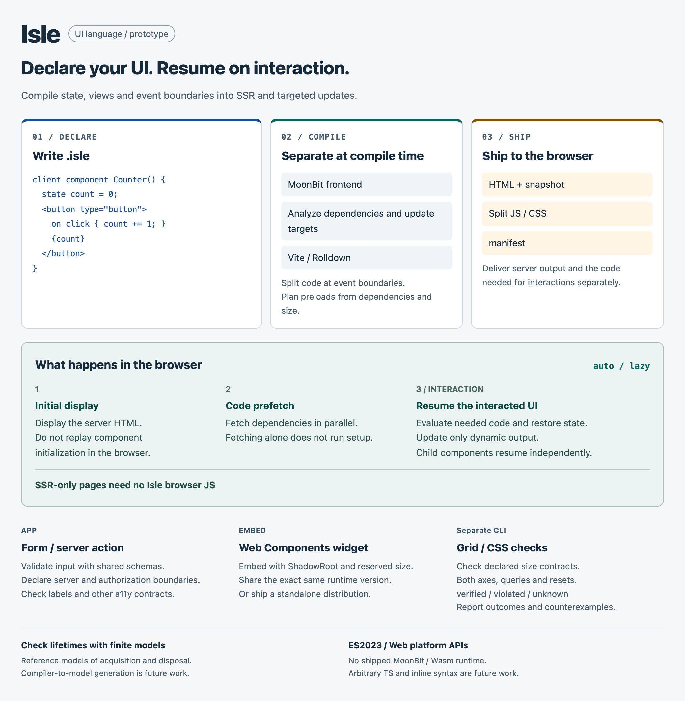

# Isle

English · [日本語](README.ja.md)

[Documentation & live demos](https://mizchi.github.io/isle/)

[Open the playground](https://mizchi.github.io/isle/playground/) to edit Isle, props and CSS, run the compiler locally in your browser, and inspect SSR HTML, resume modules and analysis. Includes counters, keyed lists, nested components and SSR-only examples. [Browser API](docs/playground.md).

Build server-rendered apps and embeddable Web Components with resumable interactions. Write state, views and event boundaries in `.isle`; the compiler generates targeted DOM updates and lets Vite / Rolldown split the code you ship.

<picture>
  <source media="(max-width: 760px)" srcset="docs/overview/figures/isle-overview.en.mobile.png">
  
</picture>

The browser displays the server's HTML without replaying component initialization. With the default `auto` policy, code can be fetched early while state restoration, resource setup and handlers wait for interaction. Child components resume independently. SSR-only pages emit no Isle browser JavaScript.

## Quick start

Use Node.js 24+ and Vite 8 (8.3.5 or later). The package includes the compiled frontend and depends on Z3 Wasm for layout checks. App developers do not need MoonBit, a Z3 executable or a compiler checkout.

**Preview distribution:** the package is currently private. [Download the preview npm archive](artifacts/isle-prototype-0.0.1.tgz) and install it in your app; registry publication is a separate step. The package name and import paths are `@isle/prototype`.

```sh
pnpm add ./isle-prototype-0.0.1.tgz
pnpm add -D vite@^8.3.5
```

After a registry release, the first command becomes `pnpm add @isle/prototype`. In your app, create these three files:

### `app.isle`

<!-- file: app.isle -->
```text
client component Counter(initial: number) {
  state count = initial;
  derive doubled = count * 2;
  event increment(event: EventSnapshot<MouseEvent>) { count += 1; }
  event reset(event: EventSnapshot<MouseEvent>) { count = initial; }
  <section>
    <h2>Counter</h2>
    <output aria-live="polite">{count} / {doubled}</output>
    <button type="button" on:click={increment}>Increment</button>
    <button type="button" on:click={reset}>Reset</button>
  </section>
}
```

### `index.html`

<!-- file: index.html -->
```html
<!doctype html>
<html lang="en">
<head>
  <meta charset="utf-8">
  <meta name="viewport" content="width=device-width, initial-scale=1">
  <title>My Isle app</title>
  <style>
    body { max-width: 640px; margin: 32px auto; padding: 0 16px; font: 18px/1.6 system-ui; }
    button { display: block; min-height: 44px; margin: 8px 0; padding: 8px 16px; font: inherit; }
  </style>
</head>
<body>
  <h1>My Isle app</h1>
  <!--isle:ssr-->
</body>
</html>
```

### `vite.config.mjs`

<!-- file: vite.config.mjs -->
```js
import { defineConfig } from 'vite';
import { fileURLToPath } from 'node:url';
import { isle } from '@isle/prototype/vite';

export default defineConfig({
  plugins: [isle({
    entry: fileURLToPath(new URL('./app.isle', import.meta.url)),
    mounts: [{ component: 'Counter', props: { initial: 5 }, label: 'Counter' }],
  })],
  build: { target: 'es2023' },
});
```

Run `pnpm exec vite` and open the URL it prints. The counter starts at `5 / 10`; Increment changes it to `6 / 12`, and Reset restores the initial value. Build with `pnpm exec vite build`, then inspect or serve `dist/`.

There is no browser entry to write for this example. `<!--isle:ssr-->` marks where the plugin inserts server-rendered HTML; it also emits the loader and chunks needed for interaction.

This build generates the initial HTML at build time. Request-time server actions need a server adapter; the example does not set up a general-purpose request-time page renderer. Write ordinary JavaScript setup/host modules for app logic outside the constrained `.isle` declarations.

## What you can build

| Feature | Try and observe |
| --- | --- |
| [TodoMVC](examples/todomvc/) | Add, edit, filter and persist todos; compare production sizes with Qwik and Preact. |
| [Minimal counter](examples/hello/) | Increment and reset a server-rendered value. |
| [HTML without browser JS](examples/ssr-only/) | Inspect the build: HTML and CSS, with no Isle runtime, snapshots or handler chunks. |
| [Selective DOM updates](examples/partial-updates/) | Change one value while the static heading and unrelated output keep their DOM identity. |
| [Nested components](examples/composition/) | Resume a child independently of its parent; project children through a pure component. |
| [Branches, keyed lists and errors](examples/control-flow/) | Switch branches, reorder keyed rows, then empty the list to reach the For fallback and ErrorBoundary. |
| [Manifest-driven loading](examples/loading/) | Inspect preload decisions in the manifest; typing activates Search while Details stays inactive. |
| [Resource lifetime and cleanup](examples/resources/) | Activate an owned timer and listener, remove the component, and observe one cleanup. |
| [Lazy CSS readiness](examples/styles/) | Load component CSS with its setup module and inspect the style seen by setup. |
| [Native navigation hints](examples/navigation/) | Inspect a native Speculation Rules data block and follow an ordinary link; no Isle browser JS is emitted. |
| [Native form validation](examples/form/) | Try invalid input, required consent and successful submission with accessible labels. |
| [Shared schema and server validation](examples/schema-form/) | Submit taken@example.com, correct it, then submit and reset the shared-schema form. |
| [Explicit server action](examples/counter/) | Compare independent counters and rename a document through a validated, authorized server boundary. |
| [CSS contract outcomes](examples/layout-contracts/) | Check reset-aware Grid/subgrid contracts; distinguish verified, violated and unknown. |
| [Checked responsive build](examples/responsive-checked/) | Verify delivered HTML/CSS across a width × height domain; fail builds on violations and unknowns. |
| [Checked branches and scrollbars](examples/responsive-dynamic/) | Check every bounded list structure and declared native scrollbar geometry. |
| [Portable Web Components](examples/portable-widget/) | Mount independent widgets, compare shared and standalone distributions, and reject a version mismatch. |
| [Cloudflare Workers widget](examples/worker-widget/) | Use two terminals for widget-dev and widget-host; embed fixed-size Shadow DOM widgets on another origin. |

[Browse all examples](examples/README.md). Each directory explains what to try, which source/configuration controls it, and how to verify it. The `just` commands there run the repository demos; your own app uses its Vite commands and the public package imports above.

## Choose the boundaries

- `component Label(title: string)` declares a pure component usable on either side. Add `client` for state/events or `server` to restrict rendering to the server.
- [`event` and `on:click`](docs/events.md) declare typed event inputs and DOM bindings. Add `.preventDefault` for synchronous cancellation before lazy loading; bodies need no `inline(ts)`.
- [Template CSS](docs/inline-css.md) uses static, scoped `<style>` blocks. Checked builds use Z3 to reject layout violations within declared width/height ranges; the playground runs Z3 Wasm on demand.
- [`Show`, `For`, `Switch` / `Match` and `ErrorBoundary`](docs/control-components.md) compile to selective updates. Put each row's `key` on its returned root, or a `Fragment` for multiple roots. Props passed into a client component are immutable initial values.
- Server actions declare schemas, authorization and effects. Provide your authentication, policies and operations through a server host. Static hosting alone does not execute actions.
- `resources` connects an ordinary setup module to an interactive component's lifetime. CSS imported by that module is prepared before setup; removal disposes owned resources.
- `loading: 'auto' | 'lazy' | 'preload' | 'eager'` controls resolution. Preload fetches code; eager can evaluate it at startup. Speculation Rules target page navigation separately.
- `widget` builds a generated loader and descriptor for third-party Web Components. Reserve width/height, choose shared or standalone, and require exact runtime versions.

Browser output targets ES2023 and native DOM / ESM / fetch. It ships no MoonBit/Wasm runtime or polyfills. Only dynamic regions receive generated update code; this is not a guarantee of lower latency for every application.

## Package APIs and guides

| Import / command | Purpose |
| --- | --- |
| `@isle/prototype/vite` | Vite plugin: SSR, chunking, loading, resources, widgets and cost budgets |
| `@isle/prototype/compiler` | Compile and inspect a constrained `.isle` program on the server/build machine |
| `@isle/prototype/server` | Connect `createActionHandler()` to a Request/Response server adapter |
| `@isle/prototype/widget` / `widget/browser` | Render an embed tag / use the browser widget API |
| `@isle/prototype/layout` | Analyze declared CSS/Grid contracts |
| `@isle/prototype/layout/z3` / `layout/z3/node` | Verify layout models with Z3 in a Worker / Node; return proofs or counterexamples |
| `@isle/prototype/resources` | Resource-owner APIs and types |
| `pnpm exec isle` | Inspect source, manifests, cost budgets and layout contracts |

The feature examples are bilingual. Detailed guides are currently in Japanese: [composition](docs/composition.md), [forms](docs/forms.md), [control flow](docs/control-flow.md), [loading](docs/resolution-optimizer.md), [widgets](docs/widgets.md), [CSS contracts](docs/layout-checking.md), [all documentation](docs/README.md).

## Current scope

Isle is a prototype with a constrained expression/type subset, not an arbitrary TypeScript runtime. `inline(ts/moonbit/css)`, Content Mappers, general async server rendering and class-level CSS elimination are not implemented. The schema subset includes closed records/arrays for supported control flow.

CSS checks apply to declared size, wrapping and overflow contracts and return `verified`, `violated` or `unknown`; they do not prove arbitrary browser layout. Finite lifecycle/security models are independent reference models. Compiler-to-model generation and a proof of the whole compiler/runtime/browser are future work. Demo server hosts use fixed principals and in-memory data.

[Contributor setup and checks](docs/contributing.md) · [Design](docs/design.md) · [Models](models/README.md) · [Benchmarks](benchmarks/README.md) · [Authoring evaluations](evals/README.md)
