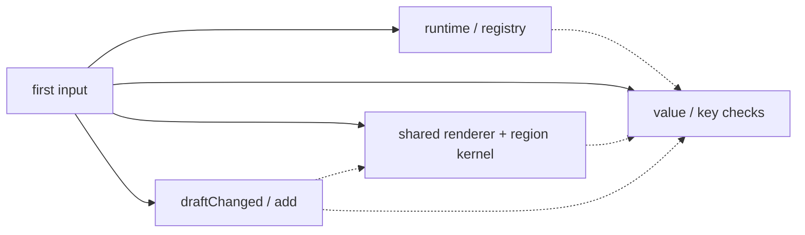

# TodoMVC のチャンク分割をプロファイラで検証

測定: 2026-11-06T04:09:04.368Z。対象アプリの基準 commit: `727d65f`、production manifest: `c309e5bff9812a89`。

**イベントの遅延と依存チャンクの並列取得は機能している。一方、共通描画モジュールが大きく、通常キー入力にも不要な配列検査・一覧更新候補の処理が残る。** ファイル数を増やすことより、生成コードの用途を分ける方を優先したい。

## 取得と評価

空の localStorage では初期取得は bootstrap / browser host の 1439 B gzip、1ファイルだけ。未操作の handler・region runtime は評価されなかった。最初の input で次の4ファイルを取得する。

| 役割 | gzip B |
|---|---:|
| runtime / registry | 1755 |
| 値・key の検査 | 511 |
| 共通描画 + region kernel | 3127 |
| draftChanged / add | 331 |
| 追加合計 | 5724 |

この時点で全生成 JS の **82.7%**（7163 / 8663 B gzip）が到着する。編集・フィルターの handler ファイルすべてが来るわけではないが、それらの表示を扱う共通描画コードは来る。

500件を保存済みの別試行では、host の restore が起動時に走り、初期外部 JS は 7116 B gzip だった。空の localStorage の値を再訪ユーザーへそのまま一般化しない。

実線は操作時に有効化する並列取得、破線は静的 import。後続 handler の dynamic import は省略した。

80 ms のレスポンス遅延、1 MiB/s、同じ Node HTTP/1.1 server で比較した。標準構成では4リクエストの開始差が **0.2 ms**、最初の開始から最後の完了まで **94.3 ms**。HTML 内の並列取得用 template を取り除く対照実験では開始差 263.4 ms、取得区間 **352.8 ms** となった。manifest から生成した inert modulepreload を操作時に移す処理は有効である。

module body の先頭に診断用 mark を置いた別試行でも確認した。`auto` は先読みした依存を初期に評価せず、最初の操作で評価した。**fetch と evaluate は分離されている。** この mark は配布コードやサイズ比較には含めていない。

## 7ファイル、13ファイル、auto の比較

数字は gzip level 6 をファイルごとに圧縮した合計。初期 = load + 2秒 idle + 操作後の新しい250ms quiet window。JS は URL ごとに重複排除する。未要求の manifest / cost report と HTTP header は含めない。

| 構成 | handlerファイル数 | 全JS B | 初期外部JS B | 初回input追加 B / 件 | input取得区間 ms | 次のEnter追加 B |
|---|---:|---:|---:|---:|---:|---:|
| production | 7 | 8663 | 1439 | 5724 / 4 | 94.3 | 0 |
| no-hints | 7 | 8663 | 1439 | 5724 / 4 | 352.8 | 0 |
| ungrouped | 13 | 9577 | 1440 | 5602 / 4 | 95.2 | 287 |
| auto | 7 | 8672 | 7534 | 0 / 0 | 取得済み | 351 |

- 1 handler / file では初回 input が 122 B 小さくなるが、次の Enter に 287 B の追加取得が発生する。全 JS は 914 B 増える。現在の小さい handler の結合には意味がある。
- `auto` は初期に 7534 B を先読みし、input の追加取得をなくす。これは初期取得量との交換条件であり、初期ペイロードを最優先する現在のデモでは `lazy` を保つ根拠になる。
- 別出力 URL の名前による微小なサイズ差も含む。1回の診断であり、実ネットワークや HTTP/2 / HTTP/3 の速度差を代表しない。

現在の物理グループは以下。source byte budget と宣言順でまとまり、`lazy` 指定時にはイベントの優先度を使わない。`remove / editChanged`、`editBlur / clear` は操作の関連よりサイズで相乗りしている。

| 物理ファイル | 論理境界 | gzip B |
|---|---|---:|
| TodoMVC.g0-cbmcDR6s.js | add / draftChanged | 331 |
| TodoMVC.g6-BAAhPPs-.js | clear / editBlur | 282 |
| TodoMVC.g3-BhPAB2YU.js | edit / editDouble | 197 |
| TodoMVC.g4-rd6Wj3Ly.js | editChanged / remove | 221 |
| TodoMVC.editKey-CWpItwbf.js | editKey | 280 |
| TodoMVC.g1-RVUEwiF1.js | restore / route | 284 |
| TodoMVC.g2-haX6iJWD.js | toggle / toggleAll | 236 |

## 大きいのは共通描画モジュール

共通モジュールは **9760 B raw / 3127 B gzip**。V8 の block coverage では、最初の input までの実行範囲が 2813 B、**71.2% がその時点で未実行**だった。この割合をそのまま削除可能量とは解釈しない。追加・編集等で後から使う処理や、エラー経路も含む。

コードからも、全 handler が同じ `virtual:isle-regions/TodoMVC` を静的 import し、全 block factory を共有していることが分かる。さらに root 用 HTML factory と更新関数の両方を生成している。root の既存 SSR DOM には更新関数（spec[1]）を使い、fresh は子 block を生成するので、**SSR と重複する root HTML factory は除去候補**である。これは coverage だけでなく呼び出し経路を読んだ判断。

参照: [生成する block factory](../../../../lib/region-codegen.mjs)、[region の初回接続と fresh](../../../../runtime/regions.mjs)。

## CPU と通常キー入力

CPU は production の JS を変更せず、V8 の最適化を許した別試行で採取した。1 ms 間隔のサンプリングなので、ごく短い処理で sample が0でも CPU が0とはいえない。Chrome trace と `.cpuprofile` の原本を保存した。

500件を localStorage から復元し、64文字を入力して最後に Enter で確定する。両方式とも最終結果は同じ501件と同じ追加文字列で検査した。

| 入力方式 | region.prepare 呼出 | region.each 呼出 | app URL の sampled self ms（参考） |
|---|---:|---:|---:|
| 通常キー（keydown + input） | 129 | 65 | 18.7 |
| input イベントだけ | 65 | 1 | 1.5 |

input だけなら一覧の照合は最後の Enter の1回。通常キーでは64回の非 Enter でも余分に照合している。原因は `TodoMVC.add` が全 keydown に結び付き、非 Enter では `items = items` となることと、生成 code が実際の変化によらず `items / draft` を dirty として渡すこと。setter は同じ配列でも型を再検査する。CPU サンプルには値検査と region 処理が現れた。

| keyboard 試行の関数 | source map で対応した場所 | sampled self ms |
|---|---|---:|
| (anonymous) | runtime/regions.mjs:126 | 4.9 |
| rowKey | runtime/value.mjs:17 | 3.8 |
| validValue | runtime/value.mjs:2 | 3.8 |
| s | TodoMVC-B1TjmQfm.js | 2.5 |
| (anonymous) | runtime/regions.mjs:135 | 1.3 |
| (anonymous) | runtime/regions.mjs:125 | 1.2 |
| attribute | runtime/regions.mjs:93 | 0.6 |
| (anonymous) | runtime/value.mjs:4 | 0.4 |

呼出回数は別の coverage 試行で数えた正確な回数。CPU は少ないサンプルの推計なので、上の時間比を性能倍率として断定しない。待機・Playwright の操作処理を app CPU に足していない。native 側の処理時間や描画全体を網羅した数値でもない。

## 診断 build の User Timing

profile 有効 + module mark の別試行。以下は入力から transaction 完了までの経過時間で、CPU 時間・INP ではない。

| 構成 | interaction ms | runtime ms | code ms | restore ms | run ms |
|---|---:|---:|---:|---:|---:|
| profile | 94.6 | 91.4 | 2.0 | 0.2 | 0.4 |
| profile-no-hints | 349.9 | 175.1 | 174.1 | 0.1 | 0.5 |

## 改善の優先順

1. SSR と重複する root の HTML factory を browser code から落とす。単なるファイル分割より総量を減らせる可能性がある。
2. コンパイラで非 Enter の no-op を検出し、キー条件を取得・復元の前で判定する。実際に変わった slot だけを dirty にし、同一配列の再検査・一覧照合を避ける。
3. 入力だけの scalar patch と、一覧の生成・照合、編集 UI の更新依存を分ける。renderer を分けるには、handler の import だけでなく region factory の依存単位も変える必要がある。
4. 1 handler / file を既定にする変更は後回し。現在の7分割と並列取得を基準に、初回・後続・総量を同時に比較する。

本分析では production の compiler / runtime / loading 方針は変更していない。既存ビルド設定の共通化は、hidden source map を作っても production manifest と JS サイズが変わらないことを deepEqual で確認した。

## 再現と原本

`just todomvc-profile`。Node v24.21.0、Chromium 156.0.8078.4、darwin/arm64。CPU と詳細 coverage は別 context。coverage は V8 の最適化を無効にするため、そこで得た時間を production CPU として使わない。module 評価 mark と User Timing も独立した試行。

- [CPU: cold input](raw/cold-input.cpuprofile)、[CPU: 通常キー入力](raw/warm-keyboard.cpuprofile)、[CPU: input のみ](raw/warm-input.cpuprofile)。DevTools の Performance に読み込める。
- [Chrome trace: cold](raw/cold.trace.json.gz)、[通常キー入力](raw/warm-keyboard.trace.json.gz)。必要なら gzip を展開して読み込む。
- [要約 JSON](latest.json)、[全結果 JSON gzip](raw/full.json.gz)、[V8 coverage 詳細](raw/production.coverage.json.gz)。相互に重なる範囲は最も内側の count を使い、UTF-16 offset から UTF-8 bytes を計算している。
- CPU の negative time delta は捨てず、絶対 timestamp を復元して順序を直す。sample 間を開始側の関数へ配分し、最後は recording end までとした推計。missing sample の補間は行わない。通常 JS は診断用 source map で追える。compiler 生成の virtual JS は map がなく、直前の native module の末尾へ誤帰属させず chunk の場所を示した。生成コードから .isle への CPU source map も未実装で、イベント位置は manifest の CodeRef から辿れる。

方法の参照: [CDP Profiler](https://chromedevtools.github.io/devtools-protocol/tot/Profiler/)、[DevTools coverage](https://developer.chrome.com/docs/devtools/coverage/)、[DevTools の timestamp 並べ替え](https://github.com/ChromeDevTools/devtools-frontend/blob/main/front_end/models/cpu_profile/CPUProfileDataModel.ts)。
