# 反例ギャラリー

各パターンで、わざと違反する小さなページを静的に検査し、報告された反例の viewport で Chromium に描画した画像。赤い実線の枠が報告された箱、点線の枠が状態が変わる前の位置(動いた分が layout shift)。`node tools/counterexample-gallery.mjs` で再生成する。

## A fixed-width box wider than its column

`E_LAYOUT_ITEM_SIZE` — viewport 416 × 690px

> .card requires 480px but receives 384px on inline axis at viewport 416px × 690px

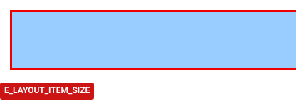

<details><summary>HTML / CSS</summary>

```html
<main class="page"><div class="card"></div></main>
```

```css
.page{display:grid;grid-template-columns:minmax(0,1fr)}.card{width:480px;height:80px;background:#9cf}
```

</details>

## A label that does not fit its button

`E_LAYOUT_CONTENT` — viewport 672 × 690px

> .label requires 12569/64px but receives 144px on inline axis at viewport 672px × 690px


<details><summary>HTML / CSS</summary>

```html
<main class="page"><div class="bar"><span class="label">Download the annual report</span></div></main>
```

```css
.page{display:grid;grid-template-columns:160px}.bar{display:grid;grid-template-columns:minmax(0,1fr);background:#246;color:#fff;padding:8px}.label{font-size:16px;line-height:24px;white-space:nowrap}
```

</details>

## A grid row too short for its item

`E_LAYOUT_ITEM_SIZE` — viewport 672 × 690px

> .a requires 70px but receives 40px on block axis at viewport 672px × 690px

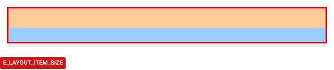

<details><summary>HTML / CSS</summary>

```html
<main class="page"><div class="a"></div><div class="b"></div></main>
```

```css
.page{display:grid;grid-template-columns:minmax(0,1fr);grid-template-rows:40px 40px;background:#eee}.a{height:70px;background:#fc9}.b{height:30px;background:#9cf}
```

</details>

## A box that makes the page scroll sideways (100vw with a scrollbar)

`E_LAYOUT_ITEM_SIZE` — viewport 672 × 690px

> .hero requires 672px but receives 657px on inline axis at viewport 672px × 690px

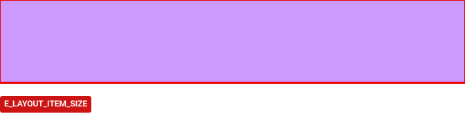

<details><summary>HTML / CSS</summary>

```html
<main class="page"><div class="hero"></div></main>
```

```css
html{overflow-y:scroll}body{padding:0}.page{display:grid;grid-template-columns:minmax(0,1fr)}.hero{width:100vw;height:120px;background:#c9f}
```

</details>

## An image whose reserved ratio differs from its file

`E_LAYOUT_IMAGE_RATIO` — viewport 320 × 480px

> .hero reserves the ratio 400/400 but /wide.png is 32×16: its height changes when it loads

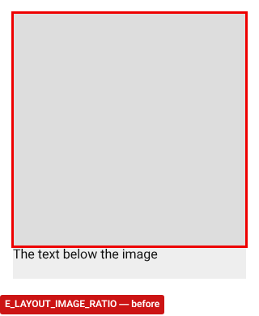 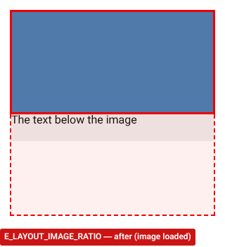

<details><summary>HTML / CSS</summary>

```html
<main class="page"><p class="after">The text below the image</p></main>
```

```css
.page{display:grid;grid-template-columns:minmax(0,1fr)}.hero{display:block;width:100%;height:auto;background:#ddd}.after{height:40px;background:#eee}
```

</details>

## A :hover rule that grows a card and pushes the content below

`E_LAYOUT_HOVER_SHIFT` — viewport 320 × 480px

> Hovering .card moves .below (blockStart by 50px at viewport 320px × 480px): a layout shift without an excusing input. Change paint or transform on :hover, or reserve the space

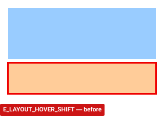 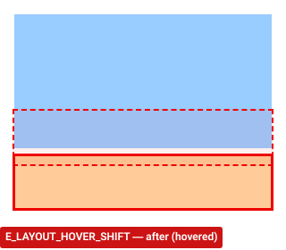

<details><summary>HTML / CSS</summary>

```html
<main class="page"><div class="card"></div><div class="below"></div></main>
```

```css
.page{display:grid;grid-template-columns:minmax(0,1fr);row-gap:8px}.card{height:100px;background:#9cf}.card:hover{height:150px}.below{height:60px;background:#fc9}
```

</details>

## A margin animation that moves the page every frame

`E_LAYOUT_ANIMATION_SHIFT` — viewport 320 × 480px

> Animation drop at 100% on .banner sets a 60px start margin, which moves it (blockStart): a layout shift while it runs. Animate transform (translate) instead of margin

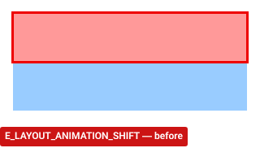 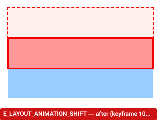

<details><summary>HTML / CSS</summary>

```html
<main class="page"><div class="banner"></div><div class="below"></div></main>
```

```css
@keyframes drop{from{margin-top:0}to{margin-top:60px}}.page{display:grid;grid-template-columns:minmax(0,1fr)}.banner{height:60px;background:#f99;animation:drop 1s infinite}.below{height:60px;background:#9cf}
```

</details>

## Carousel slides of different heights

`E_LAYOUT_CAROUSEL_SHIFT` — viewport 320 × 480px

> Switching .c from .s1 to .s2 moves .below (blockStart by 80px at viewport 320px × 480px): slides of different sizes shift the page. Give the slide area a fixed height or aspect-ratio, or stack the slides in one grid cell

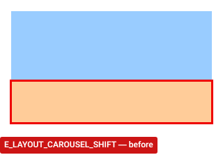 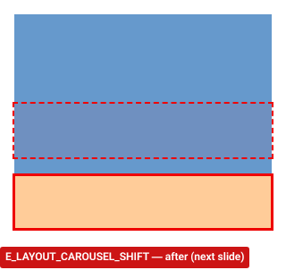

<details><summary>HTML / CSS</summary>

```html
<main class="page"><section class="c" aria-roledescription="carousel" aria-label="News"><div class="s1" aria-roledescription="slide"></div><div class="s2" aria-roledescription="slide" hidden></div></section><div class="below"></div></main>
```

```css
.page{display:grid;grid-template-columns:minmax(0,1fr)}.c{display:grid;grid-template-columns:minmax(0,1fr)}.s1{height:100px;background:#9cf}.s2{height:180px;background:#69c}.below{height:60px;background:#fc9}
```

</details>

## Web-font text whose height follows the font

`W_LAYOUT_FONT_SWAP` — viewport 332 × 480px

> .t is set in the web font Roboto (font-display: swap) and takes its height from its text: when the font file arrives the text is laid out again. Use font-display: optional, preload the font, match the fallback metrics (size-adjust, ascent-override, descent-override), or reserve the box's height

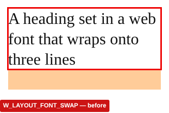 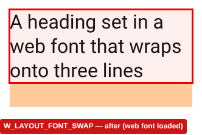

<details><summary>HTML / CSS</summary>

```html
<main class="page"><h1 class="t">A heading set in a web font that wraps onto three lines</h1><div class="below"></div></main>
```

```css
@font-face{font-family:Roboto;src:url(/roboto.ttf);font-display:swap}.page{display:grid;grid-template-columns:300px}.t{font-family:Roboto,serif;font-size:32px;line-height:40px;font-weight:400}.below{height:40px;background:#fc9}
```

</details>

## loading="lazy" on an image above the fold

`W_LAYOUT_LAZY_IN_VIEWPORT` — viewport 320 × 480px

> .hero has loading="lazy" but is in the initial viewport (top 16px at viewport 672px × 690px): it loads later than an eager image; drop loading="lazy" for images above the fold (and consider fetchpriority="high" for the largest one)

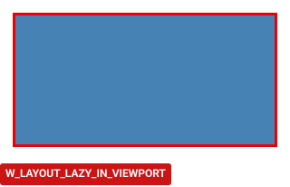

<details><summary>HTML / CSS</summary>

```html
<main class="page"></main>
```

```css
.page{display:grid;grid-template-columns:minmax(0,1fr)}.hero{display:block;width:100%;height:auto}
```

</details>

## A sizes attribute smaller than the rendered width

`W_LAYOUT_SIZES_SMALL` — viewport 320 × 480px

> .hero is laid out 640px wide at viewport 672px but its sizes attribute says 168px: the browser picks a srcset file for the smaller width, so the image is upscaled (blurry). Make sizes match the layout width

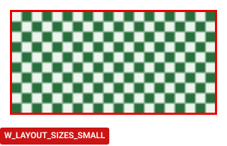

<details><summary>HTML / CSS</summary>

```html
<main class="page"></main>
```

```css
.page{display:grid;grid-template-columns:minmax(0,1fr)}.hero{display:block;width:100%;height:auto}
```

</details>

## A two-line clamp that cuts the title

`W_LAYOUT_LINE_CLAMPED` — viewport 320 × 480px

> .t is clamped to 2 lines and its text needs 3 at viewport 672px: the rest of the text is cut off (keep the full text available elsewhere, such as the page the card links to)

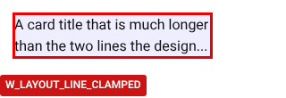

<details><summary>HTML / CSS</summary>

```html
<main class="page"><p class="t">A card title that is much longer than the two lines the design allows</p></main>
```

```css
.page{display:grid;grid-template-columns:220px}.t{font-size:16px;line-height:24px;display:-webkit-box;-webkit-box-orient:vertical;-webkit-line-clamp:2;overflow:hidden;background:#eef}
```

</details>

## A sticky header wrapped in a box of its own height

`W_LAYOUT_STICKY_INERT` — viewport 320 × 480px

> .h is position: sticky, but its parent .wrap ends at its bottom: it scrolls away like a static box. Make it a child of the scrolling content (or give the parent the height it should stick across)

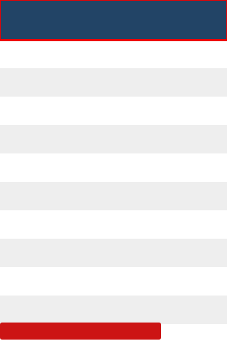 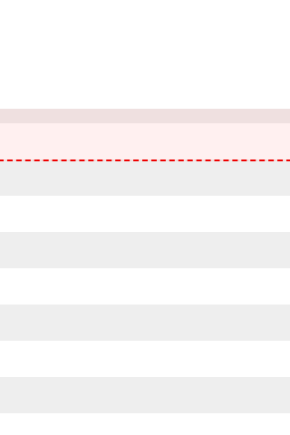

<details><summary>HTML / CSS</summary>

```html
<main class="page"><div class="wrap"><header class="h"></header></div><div class="content"></div></main>
```

```css
body{padding:0}.page{display:grid;grid-template-columns:minmax(0,1fr)}.wrap{display:grid;grid-template-columns:minmax(0,1fr)}.h{position:sticky;top:0;height:56px;background:#246}.content{height:1600px;background:repeating-linear-gradient(#fff 0 40px,#eee 40px 80px)}
```

</details>

## A sticky header inside overflow: hidden

`W_LAYOUT_STICKY_SCROLLER` — viewport 320 × 480px

> .h is position: sticky inside .page, which has overflow: hidden: it sticks to that box, which does not scroll, so it never sticks to the page. Use overflow: clip on the ancestor, or move the sticky box out of it

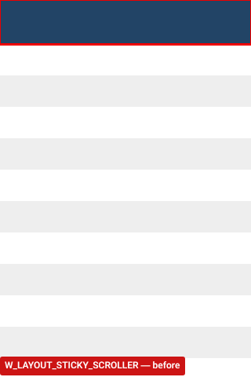 

<details><summary>HTML / CSS</summary>

```html
<main class="page"><header class="h"></header><div class="content"></div></main>
```

```css
body{padding:0}.page{display:grid;grid-template-columns:minmax(0,1fr);overflow:hidden}.h{position:sticky;top:0;height:56px;background:#246}.content{height:1600px;background:repeating-linear-gradient(#fff 0 40px,#eee 40px 80px)}
```

</details>

## Grey text below 4.5:1

`E_A11Y_CONTRAST` — viewport 672 × 690px

> .t has contrast 2.85:1, below 4.5:1

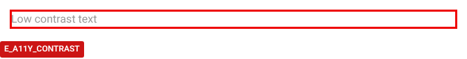

<details><summary>HTML / CSS</summary>

```html
<main class="page"><p class="t">Low contrast text</p></main>
```

```css
.page{display:grid;grid-template-columns:minmax(0,1fr)}.t{color:#999;font-size:16px;line-height:24px;white-space:nowrap}
```

</details>

## A 16 × 16 icon button

`E_A11Y_TARGET_SIZE` — viewport 672 × 690px

> .x is under 24px and its 24px circle meets .y


<details><summary>HTML / CSS</summary>

```html
<main class="page"><div class="bar"><button class="x" aria-label="Close"></button><button class="y" aria-label="Menu"></button></div></main>
```

```css
.page{display:grid;grid-template-columns:minmax(0,1fr)}.bar{display:grid;grid-template-columns:16px 16px;column-gap:2px}.x,.y{appearance:none;display:block;width:16px;height:16px;padding:0;border:0;min-width:0;min-height:0;background:#c33}
```

</details>

## A button covered by a later box

`E_A11Y_OCCLUDED` — viewport 672 × 690px

> .a is covered by .b, which is painted later and receives the pointer

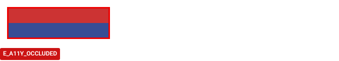

<details><summary>HTML / CSS</summary>

```html
<main class="page"><button class="a" aria-label="Buy"></button><div class="b"></div></main>
```

```css
.page{display:grid;grid-template-columns:200px;grid-template-rows:30px 30px}.a{appearance:none;display:block;height:60px;padding:0;border:0;min-width:0;min-height:0;background:#c33}.b{background:rgba(40,80,160,.9)}
```

</details>

## outline: none without another focus style

`E_A11Y_FOCUS_VISIBLE` — viewport 672 × 690px

> .b shows no focus indicator: the outline is removed and nothing else changes on focus


<details><summary>HTML / CSS</summary>

```html
<main class="page"><button class="b" aria-label="Save"></button></main>
```

```css
.page{display:grid;grid-template-columns:120px}.b{appearance:none;display:block;height:44px;padding:0;border:0;min-width:0;min-height:0;background:#246}.b:focus{outline:none}
```

</details>

## Grid placement that reverses the reading order

`W_A11Y_ORDER` — viewport 672 × 690px

> .b comes after .a in the DOM but is placed before it

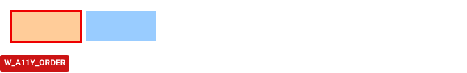

<details><summary>HTML / CSS</summary>

```html
<main class="page"><div class="row"><a class="a" href="/1" aria-label="First"></a><a class="b" href="/2" aria-label="Second"></a></div></main>
```

```css
.page{display:grid;grid-template-columns:minmax(0,1fr)}.row{display:grid;grid-template-columns:100px 100px;column-gap:8px}.a{grid-column:2;grid-row:1;display:block;height:44px;background:#9cf}.b{grid-column:1;grid-row:1;display:block;height:44px;background:#fc9}
```

</details>

## An icon link with no accessible name

`E_A11Y_NAME` — viewport 672 × 690px

> .icon has no accessible name here: no rendered text and no aria-label, aria-labelledby or title

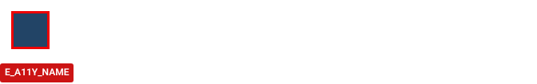

<details><summary>HTML / CSS</summary>

```html
<main class="page"><a class="icon" href="/cart"></a></main>
```

```css
.page{display:grid;grid-template-columns:44px}.icon{display:block;height:44px;background:#246}
```

</details>

## Content that needs horizontal scrolling at 320px

`E_A11Y_REFLOW` — viewport 320 × 690px

> .table makes the page scroll horizontally at 320 CSS px

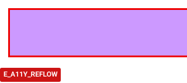

<details><summary>HTML / CSS</summary>

```html
<main class="page"><div class="table"></div></main>
```

```css
.page{display:grid;grid-template-columns:minmax(0,1fr)}.table{width:600px;height:80px;background:#c9f}
```

</details>

## Two targets that overlap

`E_A11Y_TARGET_OVERLAP` — viewport 672 × 690px

> .go and .more overlap


<details><summary>HTML / CSS</summary>

```html
<main class="page"><button class="go" aria-label="Go"></button><a class="more" href="/more" aria-label="More"></a></main>
```

```css
.page{display:grid;grid-template-columns:200px;grid-template-rows:44px;position:relative}.go{appearance:none;display:block;padding:0;border:0;min-width:0;min-height:0;height:44px;background:#246}.more{position:absolute;left:150px;top:10px;width:80px;height:44px;display:block;background:rgba(220,120,40,.85)}
```

</details>

## A focused button entirely under another box

`E_A11Y_FOCUS_OBSCURED` — viewport 672 × 690px

> .go is entirely hidden behind .cover when focused

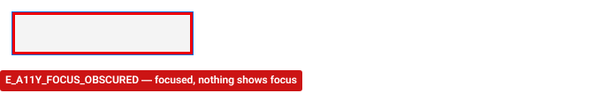

<details><summary>HTML / CSS</summary>

```html
<main class="page"><button class="go" aria-label="Pay"></button><div class="cover"></div></main>
```

```css
.page{display:grid;grid-template-columns:200px;grid-template-rows:44px;position:relative;background:#fff}.go{appearance:none;display:block;padding:0;border:0;min-width:0;min-height:0;height:44px;background:#246}.go:focus{outline:3px solid #1a73e8}.cover{position:absolute;left:0;top:0;width:200px;height:44px;background:#f4f4f4}
```

</details>

## A hover color with too little contrast

`E_A11Y_STATE_CONTRAST` — viewport 672 × 690px

> .b has contrast 1.92:1 when hovered, below 4.5:1

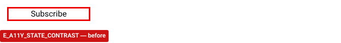 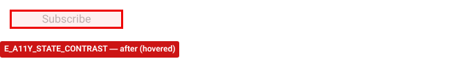

<details><summary>HTML / CSS</summary>

```html
<main class="page"><button class="b">Subscribe</button></main>
```

```css
.page{display:grid;grid-template-columns:160px;background:#fff;color:#000}.b{appearance:none;display:block;padding:0;border:0;min-width:0;min-height:0;font-family:Roboto;font-size:16px;line-height:24px;background:#fff;color:#000;white-space:nowrap}.b:hover{color:#bbb}
```

</details>

## A pale focus outline

`E_A11Y_FOCUS_CONTRAST` — viewport 672 × 690px

> .b's focus outline has contrast 1.36:1 against its backdrop, below 3:1

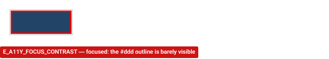

<details><summary>HTML / CSS</summary>

```html
<main class="page"><button class="b" aria-label="Save"></button></main>
```

```css
.page{display:grid;grid-template-columns:120px;padding:8px;background:#fff}.b{appearance:none;display:block;padding:0;border:0;min-width:0;min-height:0;height:44px;background:#246}.b:focus{outline:3px solid #ddd;outline-offset:2px}
```

</details>

## A button inside overflow: clip, below the clip edge

`E_A11Y_FOCUS_CLIPPED` — viewport 672 × 690px

> .b lies outside .c, whose overflow: clip never scrolls it into view when focused

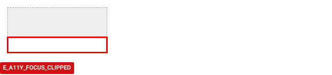

<details><summary>HTML / CSS</summary>

```html
<main class="page"><div class="c"><div class="s"></div><button class="b" aria-label="Next"></button></div></main>
```

```css
.page{display:grid;grid-template-columns:200px;background:#fff}.c{display:grid;grid-template-columns:minmax(0,1fr);grid-template-rows:60px 30px;height:60px;overflow:clip;outline:1px dashed #999}.s{background:#eee}.b{appearance:none;display:block;padding:0;border:0;min-width:0;min-height:0;background:#c33}
```

</details>

## A visually hidden skip link that :focus does not reveal

`E_A11Y_FOCUS_CLIPPED_AWAY` — viewport 672 × 690px

> .s takes focus but is clipped away (visually hidden) even when focused; reveal it on :focus

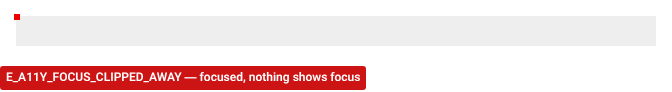

<details><summary>HTML / CSS</summary>

```html
<main class="page"><a class="s" href="#main" aria-label="Skip to content"></a><div class="d"></div></main>
```

```css
.page{position:relative;display:grid;grid-template-columns:minmax(0,1fr);grid-auto-rows:30px;background:#fff;color:#000}.s{position:absolute;left:0;top:0;width:1px;height:1px;overflow:hidden;display:block;clip:rect(0 0 0 0)}.d{background:#eee}
```

</details>

## A button that can sit entirely behind a fixed header

`E_A11Y_FOCUS_SCROLLED_UNDER` — viewport 672 × 690px

> .b can be focused while entirely behind the fixed .h (the page does not scroll it out); add scroll-padding to the viewport or scroll-margin to the element

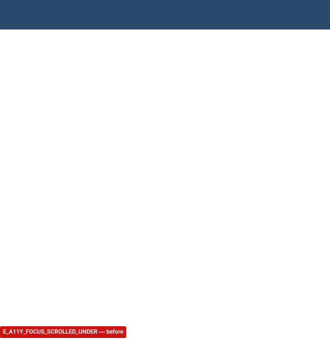 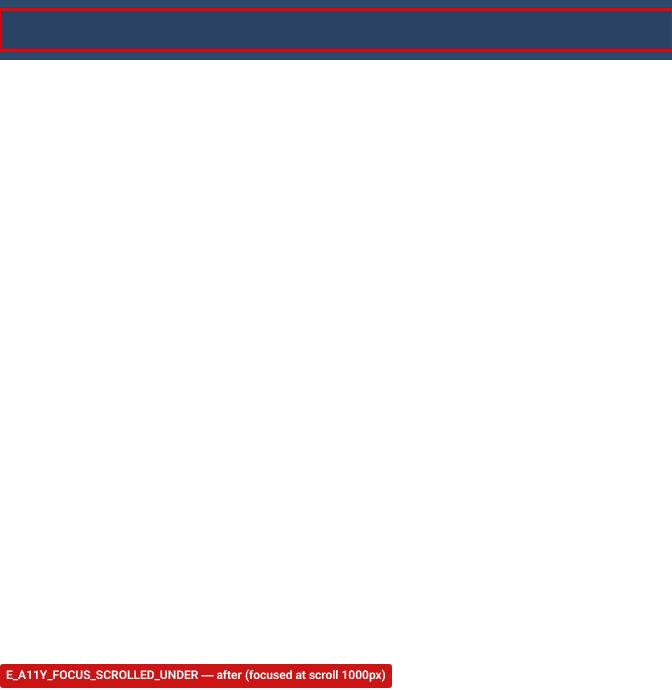

<details><summary>HTML / CSS</summary>

```html
<main class="page"><div class="h"></div><div class="gap"></div><button class="b" aria-label="Buy"></button><div class="tall"></div></main>
```

```css
body{padding:0}.page{display:grid;grid-template-columns:minmax(0,1fr);background:#fff}.h{position:fixed;top:0;left:0;width:100%;height:60px;background:rgba(36,68,102,.97)}.gap{height:1010px}.tall{height:2000px}.b{appearance:none;display:block;padding:0;border:0;min-width:0;min-height:0;height:40px;background:#c33}.b:focus{outline:3px solid #1a73e8}
```

</details>

## A fixed footer that covers the end of the page

`E_A11Y_FIXED_HIDES` — viewport 672 × 690px

> .b stays entirely behind the fixed .f at every scroll position; pad the page by the bar's size

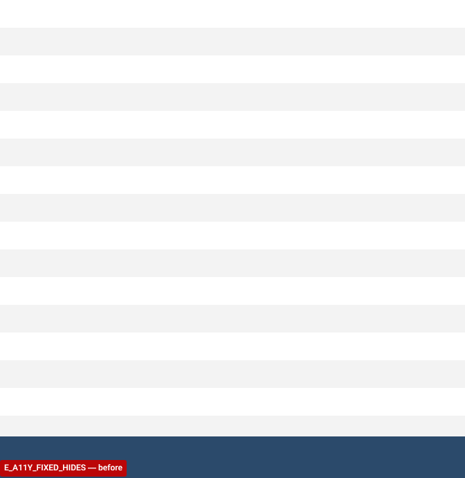 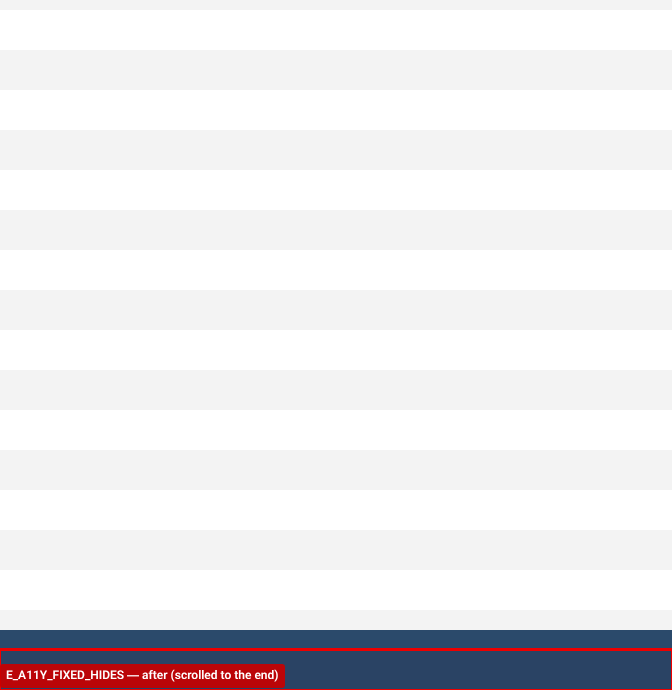

<details><summary>HTML / CSS</summary>

```html
<main class="page"><div class="gap"></div><button class="b" aria-label="Accept"></button><footer class="f"></footer></main>
```

```css
body{padding:0}.page{display:grid;grid-template-columns:minmax(0,1fr);background:#fff}.f{position:fixed;bottom:0;left:0;width:100%;height:60px;background:rgba(36,68,102,.97)}.gap{height:2000px;background:repeating-linear-gradient(#fff 0 40px,#f3f3f3 40px 80px)}.b{appearance:none;display:block;padding:0;border:0;min-width:0;min-height:0;height:40px;background:#c33}
```

</details>

## An #id jump that lands under a fixed header

`W_A11Y_FRAGMENT_UNDER_BAR` — viewport 672 × 690px

> .l jumps to #s, whose top lands behind the fixed .h; give it scroll-margin-top (or the viewport scroll-padding-top) of the bar's height

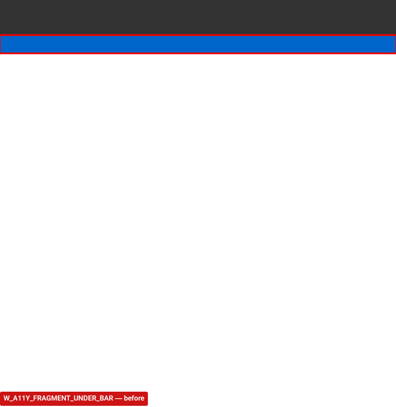 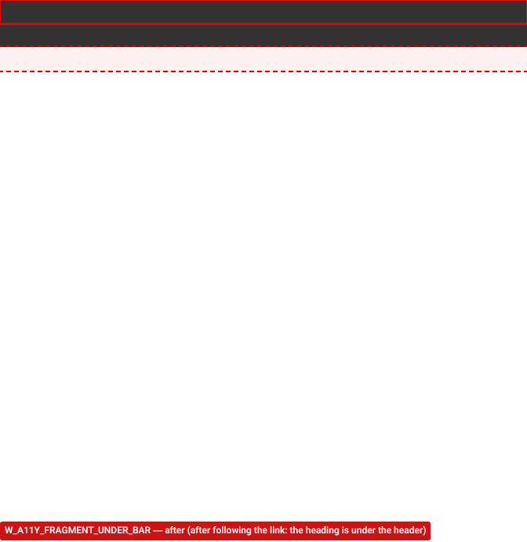

<details><summary>HTML / CSS</summary>

```html
<main class="page"><div class="h"></div><div class="top"></div><a class="l" href="#s" aria-label="Jump to pricing"></a><div class="gap"></div><h2 class="t" id="s">Pricing</h2><div class="tall"></div></main>
```

```css
body{padding:0}.page{display:grid;grid-template-columns:minmax(0,1fr);background:#fff;color:#000}.h{position:fixed;top:0;left:0;width:100%;height:60px;background:#333}.top{height:60px}.l{display:block;height:30px;background:#06c}.gap{height:1000px}.t{display:block;font-family:Roboto;font-size:20px;line-height:30px;font-weight:400;white-space:nowrap}.tall{height:2000px}
```

</details>

## A text field whose border is too faint

`E_A11Y_FIELD_BOUNDARY` — viewport 672 × 690px

> .i has no visible boundary: its fill and borders reach only 1.36:1 against the background (3:1 needed)

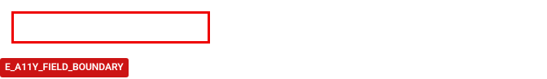

<details><summary>HTML / CSS</summary>

```html
<main class="page"><input class="i" type="text" aria-label="Email"></main>
```

```css
.page{display:grid;grid-template-columns:240px;background:#fff;color:#000}.i{appearance:none;display:block;padding:0 8px;min-width:0;min-height:0;width:240px;height:36px;border:1px solid #ddd;background:transparent;font:16px Roboto}
```

</details>

## Placeholder text with too little contrast

`E_A11Y_PLACEHOLDER_CONTRAST` — viewport 672 × 690px

> .i's placeholder has contrast 1.61:1, below 4.5:1

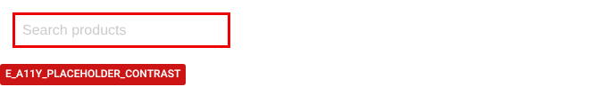

<details><summary>HTML / CSS</summary>

```html
<main class="page"><input class="i" type="text" aria-label="Search" placeholder="Search products"></main>
```

```css
.page{display:grid;grid-template-columns:240px;background:#fff;color:#000}.i{appearance:none;display:block;padding:0 8px;min-width:0;min-height:0;width:240px;height:36px;border:1px solid #000;background:#fff;font-size:16px}.i::placeholder{color:#ccc}
```

</details>

## A custom checkbox that looks the same when checked

`E_A11Y_CHECKED_INDICATOR` — viewport 672 × 690px

> .c looks the same checked and unchecked

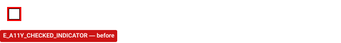 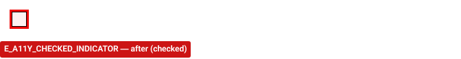

<details><summary>HTML / CSS</summary>

```html
<main class="page"><input class="c" type="checkbox" aria-label="Agree"></main>
```

```css
.page{display:grid;grid-template-columns:24px;background:#fff;color:#000}.c{appearance:none;display:block;padding:0;min-width:0;min-height:0;width:24px;height:24px;border:2px solid #000;background:#fff;margin:0}
```

</details>

## Text entirely under a later opaque box

`E_A11Y_TEXT_OBSCURED` — viewport 672 × 690px

> .t's text is entirely hidden behind .over

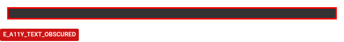

<details><summary>HTML / CSS</summary>

```html
<main class="page"><p class="t">Price: 1,200 USD</p><div class="over"></div></main>
```

```css
.page{position:relative;display:grid;grid-template-columns:minmax(0,1fr);grid-auto-rows:20px;background:#fff;color:#000}.t{display:block;font-family:Roboto;font-size:16px;line-height:20px;white-space:nowrap}.over{position:absolute;left:0;top:0;width:100%;height:20px;background:#333}
```

</details>

## Content cut off by overflow: hidden

`W_LAYOUT_CLIPPED` — viewport 672 × 690px

> .box is cut off by .box (overflow hidden)

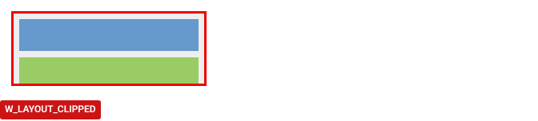

<details><summary>HTML / CSS</summary>

```html
<main class="page"><div class="box"><div class="item a"></div><div class="item b"></div><div class="item c"></div></div></main>
```

```css
.page{display:grid;grid-template-columns:240px}.box{display:grid;grid-template-columns:minmax(0,1fr);row-gap:8px;height:90px;overflow:hidden;background:#eee;padding:8px}.item{height:40px;background:#69c}.b{background:#9c6}.c{background:#c96}
```

</details>

## A control that only hover reveals

`E_A11Y_HOVER_ONLY` — viewport 672 × 690px

> .b appears on :hover but stays hidden when focused, so keyboard users cannot see it

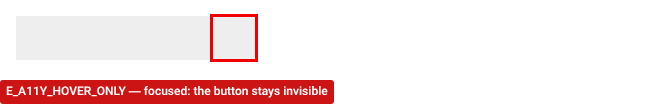

<details><summary>HTML / CSS</summary>

```html
<main class="page"><div class="row"><div class="item"></div><button class="b" aria-label="Delete"></button></div></main>
```

```css
.page{display:grid;grid-template-columns:240px;background:#fff}.row{display:grid;grid-template-columns:minmax(0,1fr) 44px;height:44px;background:#eee}.b{appearance:none;display:block;padding:0;border:0;min-width:0;min-height:0;opacity:0;background:#c33}.b:hover{opacity:1}
```

</details>

## Text cut off at 1.5 line-height (user text spacing)

`E_A11Y_TEXT_SPACING` — viewport 672 × 690px

> .t clips its text with letter-spacing 0.12em and word-spacing 0.16em (needs 197.4375px)

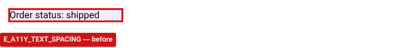 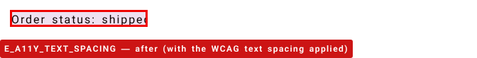

<details><summary>HTML / CSS</summary>

```html
<main class="page"><p class="t">Order status: shipped</p></main>
```

```css
.page{display:grid;grid-template-columns:190px;grid-template-rows:20px;background:#fff;color:#000}.t{font-family:Roboto;font-size:16px;line-height:20px;white-space:nowrap;overflow:hidden;background:#eef}
```

</details>

## Text below 12px on narrow screens

`W_A11Y_SMALL_TEXT` — viewport 672 × 690px

> .t is set at 10px

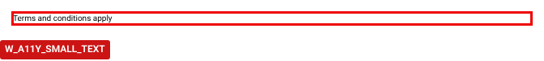

<details><summary>HTML / CSS</summary>

```html
<main class="page"><p class="t">Terms and conditions apply</p></main>
```

```css
.page{display:grid;grid-template-columns:minmax(0,1fr);background:#fff;color:#000}.t{font-family:Roboto;font-size:10px;line-height:14px;white-space:nowrap}
```

</details>

## A visible button under pointer-events: none

`E_A11Y_POINTER_DISABLED` — viewport 672 × 690px

> .go cannot be clicked: pointer-events is none here


<details><summary>HTML / CSS</summary>

```html
<main class="page"><div class="panel"><button class="go" aria-label="Continue"></button></div></main>
```

```css
.page{display:grid;grid-template-columns:160px;background:#fff}.panel{display:grid;grid-template-columns:minmax(0,1fr);pointer-events:none}.go{appearance:none;display:block;padding:0;border:0;min-width:0;min-height:0;height:44px;background:#246}
```

</details>

## A focusable button inside aria-hidden

`E_A11Y_HIDDEN_FOCUSABLE` — viewport 672 × 690px

> .b can take focus inside aria-hidden content

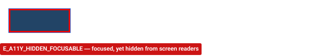

<details><summary>HTML / CSS</summary>

```html
<main class="page"><div class="bar" aria-hidden="true"><button class="b" aria-label="Share"></button></div></main>
```

```css
.page{display:grid;grid-template-columns:120px;padding:4px;background:#fff}.bar{display:grid;grid-template-columns:minmax(0,1fr)}.b{appearance:none;display:block;padding:0;border:0;min-width:0;min-height:0;height:44px;background:#246}.b:focus{outline:3px solid #1a73e8}
```

</details>

## Focus can leave an open modal dialog

`W_A11Y_MODAL_BACKGROUND` — viewport 672 × 690px

> .o can take focus outside the modal .d; make the background inert (or aria-hidden and unfocusable)

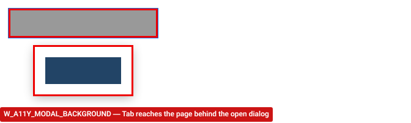

<details><summary>HTML / CSS</summary>

```html
<main class="page"><div class="bg"><button class="o" aria-label="Background action"></button></div><div class="d" role="dialog" aria-modal="true" aria-label="Confirm"><button class="i" aria-label="OK"></button></div></main>
```

```css
.page{position:relative;display:grid;grid-template-columns:240px;grid-template-rows:44px;background:#fff}.bg{display:grid;grid-template-columns:minmax(0,1fr)}.o{appearance:none;display:block;padding:0;border:0;min-width:0;min-height:0;height:44px;background:#999}.o:focus{outline:3px solid #1a73e8}.d{position:absolute;left:40px;top:60px;width:160px;height:80px;display:grid;grid-template-columns:minmax(0,1fr);padding:18px;background:#fff;box-shadow:0 4px 16px rgba(0,0,0,.3)}.i{appearance:none;display:block;padding:0;border:0;min-width:0;min-height:0;height:44px;background:#246}
```

</details>

## Padding larger than the fixed size

`E_LAYOUT_BOX_EDGES` — viewport 672 × 690px

> .pill requires 32px but receives 24px on block axis at viewport 672px × 690px

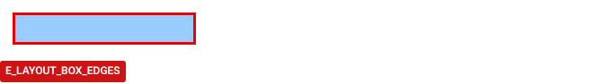

<details><summary>HTML / CSS</summary>

```html
<main class="page"><div class="pill"></div></main>
```

```css
.page{display:grid;grid-template-columns:200px}.pill{height:24px;padding:16px 0;background:#9cf}
```

</details>

## A rigid row wider than the page

`E_LAYOUT_PAGE_OVERFLOW` — viewport 422 × 690px

> .b reaches past the viewport, so the page scrolls horizontally

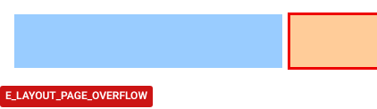

<details><summary>HTML / CSS</summary>

```html
<main class="page"><div class="row"><div class="a"></div><div class="b"></div></div></main>
```

```css
.page{display:grid;grid-template-columns:minmax(0,1fr)}.row{display:flex;column-gap:8px}.a{flex:none;width:300px;height:60px;background:#9cf}.b{flex:none;width:200px;height:60px;background:#fc9}
```

</details>

## Text that spills into its neighbour

`E_LAYOUT_TEXT_COLLISION` — viewport 429 × 690px

> .t.a and .t.b overlap


<details><summary>HTML / CSS</summary>

```html
<main class="page"><div class="row"><p class="t a">A long product name that overflows</p><p class="t b">19.99 USD</p></div></main>
```

```css
.page{display:grid;grid-template-columns:minmax(0,1fr)}.row{display:grid;grid-template-columns:minmax(0,1fr) minmax(0,1fr)}.t{font-family:Roboto;font-size:16px;line-height:24px;white-space:nowrap}.b{background:rgba(255,200,120,.5)}
```

</details>

## A scroll area inside a scroll area

`W_LAYOUT_NESTED_SCROLL` — viewport 484 × 690px

> .inner scrolls inside .outer


<details><summary>HTML / CSS</summary>

```html
<main class="page"><div class="outer"><div class="inner"><div class="content"></div></div></div></main>
```

```css
.page{display:grid;grid-template-columns:minmax(0,1fr)}.outer{display:grid;grid-template-columns:600px;overflow:auto;height:140px;background:#eee;padding:8px}.inner{display:grid;grid-template-columns:900px;overflow:auto;background:#cde}.content{min-width:0;height:100px;background:repeating-linear-gradient(90deg,#9cf 0 40px,#cde 40px 80px)}
```

</details>

## A document without lang

`E_A11Y_HTML_LANG` — markup rule (nothing to see on screen)

> html@P has no lang attribute


<details><summary>HTML / CSS</summary>

```html
<html>
  <body>
    <main class="page">…</main>
  </body>
</html>
```

```css
.page{display:grid;grid-template-columns:minmax(0,1fr)}.x{height:20px}
```

</details>

## A viewport meta tag that disables zoom

`E_A11Y_META_VIEWPORT` — markup rule (nothing to see on screen)

> The viewport meta tag disables zooming (user-scalable=no, maximum-scale=1): text cannot be enlarged to 200% on touch devices


<details><summary>HTML / CSS</summary>

```html
<head>
  <meta name="viewport" content="width=device-width, maximum-scale=1, user-scalable=no">
</head>
```

```css
.page{display:grid;grid-template-columns:minmax(0,1fr)}.x{height:20px}
```

</details>

## touch-action on body that blocks pinch-zoom

`E_A11Y_TOUCH_ZOOM` — markup rule (nothing to see on screen)

> body@P/0 has touch-action: pan-x pan-y, which disables pinch-zoom for the whole page


<details><summary>HTML / CSS</summary>

```html
<main class="page"><div class="x"></div></main>
```

```css
body{touch-action:pan-x pan-y}.page{display:grid;grid-template-columns:minmax(0,1fr)}.x{height:20px}
```

</details>

## Two elements with the same id

`E_A11Y_DUPLICATE_ID` — markup rule (nothing to see on screen)

> id "email" is used by 2 elements


<details><summary>HTML / CSS</summary>

```html
<main class="page"><label class="l" for="email" id="email">Email</label><input class="i" type="email" id="email"></main>
```

```css
.page{display:grid;grid-template-columns:200px}.l{display:block;font-family:Roboto;font-size:16px;line-height:24px;font-weight:400;white-space:nowrap}.i{appearance:none;display:block;padding:0;min-width:0;min-height:0;width:200px;height:30px;border:1px solid #000;background:#fff}
```

</details>

## aria-labelledby that points at nothing

`E_A11Y_REFERENCE` — markup rule (nothing to see on screen)

> .d references the missing id "dialog-title"


<details><summary>HTML / CSS</summary>

```html
<main class="page"><div class="d" role="dialog" aria-labelledby="dialog-title"><button class="b" aria-label="Close"></button></div></main>
```

```css
.page{display:grid;grid-template-columns:200px}.d{display:grid;grid-template-columns:44px}.b{appearance:none;display:block;padding:0;border:0;min-width:0;min-height:0;height:44px;background:#246}
```

</details>

## A button inside a link

`E_A11Y_NESTED_INTERACTIVE` — markup rule (nothing to see on screen)

> .b is interactive inside .card


<details><summary>HTML / CSS</summary>

```html
<main class="page"><a class="card" href="/item"><button class="b" aria-label="Add to cart"></button></a></main>
```

```css
.page{display:grid;grid-template-columns:200px}.card{display:grid;grid-template-columns:44px;padding:8px;background:#eee}.b{appearance:none;display:block;padding:0;border:0;min-width:0;min-height:0;height:44px;background:#246}
```

</details>

## An image without alt

`E_A11Y_IMAGE_ALT` — markup rule (nothing to see on screen)

> .p has no alt; use alt="" if it is decorative


<details><summary>HTML / CSS</summary>

```html
<main class="page"></main>
```

```css
.page{display:grid;grid-template-columns:minmax(0,1fr)}.p{display:block;width:100%;height:auto}
```

</details>

## A text field with no label

`E_A11Y_LABEL` — markup rule (nothing to see on screen)

> .i has no label here: add a visible <label>, aria-label, aria-labelledby or title


<details><summary>HTML / CSS</summary>

```html
<main class="page"><input class="i" type="text"></main>
```

```css
.page{display:grid;grid-template-columns:200px}.i{appearance:none;display:block;padding:0;min-width:0;min-height:0;width:200px;height:30px;border:1px solid #000;background:#fff}
```

</details>

## A misspelled role

`E_A11Y_ROLE` — markup rule (nothing to see on screen)

> .b has role "buton", which is not a WAI-ARIA role


<details><summary>HTML / CSS</summary>

```html
<main class="page"><div class="b" role="buton" tabindex="0" aria-label="Save"></div></main>
```

```css
.page{display:grid;grid-template-columns:120px}.b{height:44px;background:#246}
```

</details>

## A list with a non-item child

`E_A11Y_LIST` — markup rule (nothing to see on screen)

> .u has a child that is not li


<details><summary>HTML / CSS</summary>

```html
<main class="page"><ul class="u"><li class="a"></li><div class="x"></div></ul></main>
```

```css
.page{display:grid;grid-template-columns:200px}.u{display:grid;grid-template-columns:minmax(0,1fr);list-style:none;padding:0}.a,.x{display:block;height:20px}
```

</details>

## A positive tabindex

`W_A11Y_POSITIVE_TABINDEX` — markup rule (nothing to see on screen)

> .b has tabindex 3, which moves it ahead of the DOM focus order


<details><summary>HTML / CSS</summary>

```html
<main class="page"><button class="a" aria-label="First"></button><button class="b" tabindex="3" aria-label="Jumps ahead"></button></main>
```

```css
.page{display:grid;grid-template-columns:120px;row-gap:4px}.a,.b{appearance:none;display:block;padding:0;border:0;min-width:0;min-height:0;height:44px;background:#246}
```

</details>

## A heading level skipped

`W_A11Y_HEADING_ORDER` — markup rule (nothing to see on screen)

> .h.b (h3) follows h1 .h.a, skipping a level


<details><summary>HTML / CSS</summary>

```html
<main class="page"><h1 class="h a">Checkout</h1><h3 class="h b">Shipping</h3></main>
```

```css
.page{display:grid;grid-template-columns:minmax(0,1fr)}.h{display:block;font-family:Roboto;font-size:20px;line-height:28px;font-weight:400;white-space:nowrap}
```

</details>

## A heading with no text

`E_A11Y_EMPTY_HEADING` — markup rule (nothing to see on screen)

> .e is an empty heading here


<details><summary>HTML / CSS</summary>

```html
<main class="page"><h2 class="e"></h2></main>
```

```css
.page{display:grid;grid-template-columns:minmax(0,1fr)}.e{display:block;height:28px}
```

</details>

## Content outside every landmark

`W_A11Y_REGION` — markup rule (nothing to see on screen)

> .t is content outside any landmark


<details><summary>HTML / CSS</summary>

```html
<body><p class="t">Free shipping over 50 USD</p><main class="page"><div class="x"></div></main></body>
```

```css
.t{display:block;font-family:Roboto;font-size:16px;line-height:24px;white-space:nowrap}.page{display:grid;grid-template-columns:minmax(0,1fr)}.x{height:20px}
```

</details>

## Two main landmarks

`W_A11Y_MULTIPLE_MAIN` — markup rule (nothing to see on screen)

> .m2 renders as a second main landmark


<details><summary>HTML / CSS</summary>

```html
<body><main class="m1"><div class="x"></div></main><main class="m2"><div class="x"></div></main></body>
```

```css
.m1,.m2{display:grid;grid-template-columns:minmax(0,1fr)}.x{height:20px}
```

</details>

## A link named “Read more”

`W_A11Y_LINK_TEXT` — markup rule (nothing to see on screen)

> .l is named "read more", which does not say where it goes


<details><summary>HTML / CSS</summary>

```html
<main class="page"><a class="l" href="/posts/42" aria-label="Read more"></a></main>
```

```css
.page{display:grid;grid-template-columns:120px}.l{display:block;height:44px;background:#246}
```

</details>

## A link that opens a new tab without saying so

`W_A11Y_NEW_WINDOW` — markup rule (nothing to see on screen)

> .l opens in a new window or tab (target="_blank") but its name does not say so


<details><summary>HTML / CSS</summary>

```html
<main class="page"><a class="l" href="https://example.com/terms" target="_blank" aria-label="Terms of service"></a></main>
```

```css
.page{display:grid;grid-template-columns:120px}.l{display:block;height:44px;background:#246}
```

</details>

## An autocomplete value that is not an autofill token

`E_A11Y_AUTOCOMPLETE` — markup rule (nothing to see on screen)

> .i has autocomplete="e-mail", outside the HTML autofill tokens


<details><summary>HTML / CSS</summary>

```html
<main class="page"><input class="i" type="email" aria-label="Email" autocomplete="e-mail"></main>
```

```css
.page{display:grid;grid-template-columns:200px}.i{appearance:none;display:block;padding:0;min-width:0;min-height:0;width:200px;height:30px;border:1px solid #000;background:#fff}
```

</details>

## An iframe without a title

`E_A11Y_FRAME_TITLE` — markup rule (nothing to see on screen)

> .f is a frame without a title


<details><summary>HTML / CSS</summary>

```html
<main class="page"><iframe class="f" src="/map.html"></iframe></main>
```

```css
.page{display:grid;grid-template-columns:minmax(0,1fr)}.f{display:block;width:300px;height:150px;border:0}
```

</details>

## A video without a captions track

`E_A11Y_VIDEO_CAPTION` — markup rule (nothing to see on screen)

> .v has no captions track


<details><summary>HTML / CSS</summary>

```html
<main class="page"><video class="v" src="/intro.mp4" controls></video></main>
```

```css
.page{display:grid;grid-template-columns:minmax(0,1fr)}.v{display:block;width:320px;height:180px}
```

</details>

## A skip link parked left of the viewport

`E_A11Y_FOCUS_OFFSCREEN` — viewport 672 × 690px

> .skip takes focus but lies entirely off screen (before the viewport's start edge), so the focused element is never visible


<details><summary>HTML / CSS</summary>

```html
<main class="page"><a class="skip" href="#main" aria-label="Skip to content"></a><div class="d"></div></main>
```

```css
.page{position:relative;display:grid;grid-template-columns:minmax(0,1fr);grid-auto-rows:30px;background:#fff}.skip{position:absolute;left:-200px;top:0;width:160px;height:30px;display:block;background:#c33}.d{background:#eee}
```

</details>

## Content shown only in portrait

`E_A11Y_ORIENTATION` — markup rule (nothing to see on screen)

> the main content does not render in landscape viewports

 

<details><summary>HTML / CSS</summary>

```html
<main class="m"><div class="x"></div></main>
```

```css
.m{display:grid;grid-template-columns:minmax(0,1fr)}.x{height:120px;background:#9cf}@media (orientation: landscape){.m{display:none}}
```

</details>

## A badge that sticks out of its card

`E_LAYOUT_PROTRUSION` — viewport 672 × 690px

> .badge sticks out of its parent .card on the inline axis


<details><summary>HTML / CSS</summary>

```html
<main class="page"><div class="card"><div class="badge"></div></div></main>
```

```css
.page{display:grid;grid-template-columns:minmax(0,1fr);padding:24px}.card{display:grid;grid-template-columns:minmax(0,1fr);height:80px;background:#eee}.badge{height:24px;background:#c33;transform:translate(20px,-16px)}
```

</details>
