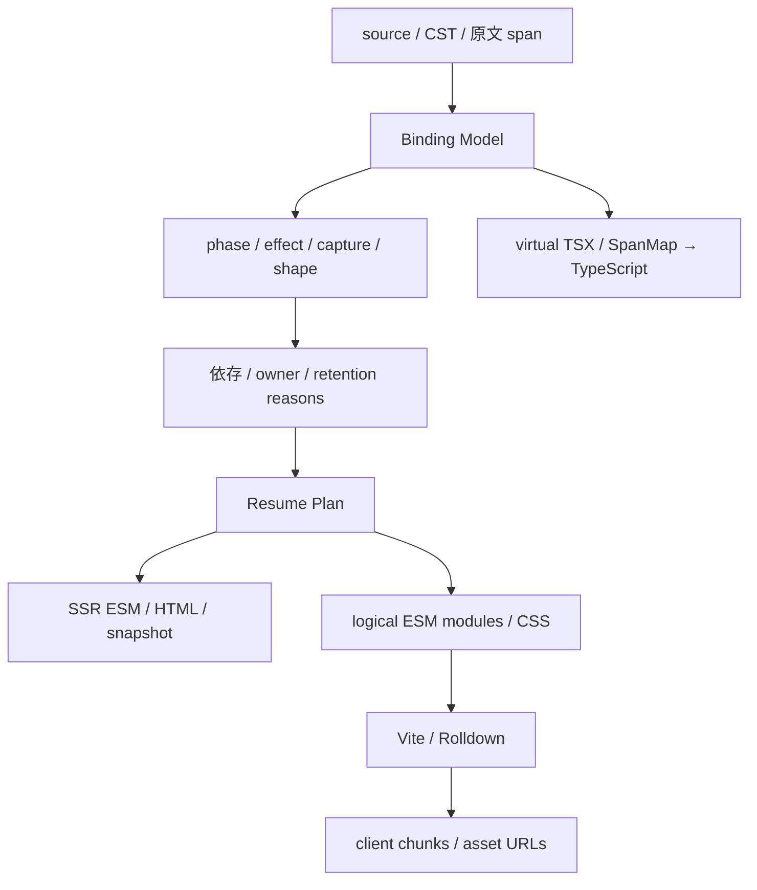

# Isle UI 言語 設計ドラフト

状態: prototype v0 を実装、詳細仕様は検討中。更新日: 2026-11-05。以下には未実装の構文・型名・ABI の提案も含む。**現在動く部分言語と制限は [記述ガイド](prototype-guide.md)、実行手順は [README](../README.md) を正本にする。** 既存 framework の実装、研究、Web 標準の根拠と採否は [調査レポート](../reports/UI%20フレームワーク%20最新技術%20設計検討.md) にまとめる。

## 1. 確定方針と今回の提案

ユーザーと確定した方針は、resume を基本にすること、Qwik の TSX／`$` 変換境界を専用文法で明確にすること、静的解析のための制約を許容すること、できるだけ portable にすること、チャンク分割は Vite／Rolldown に組み込むこと、型付けに Content Mapper を使うこと、server component と client component を明示的に分けて非同期関数のセキュリティ境界を検査可能にすることである。現行実装は MoonBit frontend と JS codegen / adapter を使う。

2026-11-05 に、UI の依存・効果・寿命を静的に解析し、再開可能なコードと状態遷移モデルを生成する言語として進める方針を採用した。型付き状態・遷移、effect / capability、task の競合方針と scope、差分 collection、accessibility の操作契約、外部 DOM の所有境界、IR からのモデル抽出を目指す。QRL 相当のコード取得・評価・活性化・commit の時期を compiler が計画し、CSS の必要性解析と Vite / Rolldown の分割・配信へつなぐ。[解決時期の最適化](resolution-optimizer.md)で実装済みの auto 計画と後続の制約グラフを区別する。

現行 v0 は **TypeScript 風の閉じた専用構文**である。次段階は宣言と境界を独立した DSL、処理本体を `inline(ts)` / `inline(moonbit)`、stylesheet を `inline(css)` で記述する方針とする（§2.1〜2.3）。DSL が実行側・状態・依存・公開 API を所有し、処理言語にその意味を依存させない。`live` の型と CSS を含む到達可能性解析は次段階の設計案で、v0 parser には未実装である。形式モデルは **MoonBit＋mizchi/veri 0.2.1** を用い、必要な意味保存の定理に Lean を追加する。UI の DSL、処理本体、コンパイラ本体、形式モデルの言語は別に選ぶ。依存・toolchain と検査対象は [形式手法の採用方針](formal-methods.md) に記録する。

本稿は、共通の必要性解析、owner と cleanup、compute／commit 分離、resource ごとの revision、event の能力分類、closed state shape、codec 検証、生成物の説明を追加提案する。採用提案とユーザーが明示した要件を同じ確定度で扱わない。

v0 は MoonBit frontend、JS codegen / server adapter、DOM runtime、Vite 8 / Rolldown の接続を持つ。SSR → 遅延 handler → 既存 DOM 更新、component の入れ子と children、制御構文、明示 action の直接 request 検査を実装した。記述・読解の評価を [evals](../evals/README.md) に置き、独立した参加者の摩擦からガイドと explain を修正する。Content Mapper、任意 TS、一般の server async render は未実装である。

Form の primitive 入力、submit、native validation、ラベルと参照の静的検査に加え、server/client 共通 schema、相関・認可付き非同期検証、型付き FormData、server field error、pending/reset を実装した。SSR 専用でも標準制約と native POST を保持する。実装範囲・次の課題・a11y の CI は [Form の契約](forms.md)にまとめる。field array、File、複数選択と HTML response adapter は後続とする。

schema は言語共通の値契約に絞り、認可後の非同期検証は action ごとの宣言へ移した。DSL と TS データ宣言は同じ [Schema IR](schema-contracts.md)へ正規化して比較する。TS の静的抽出・外部 schema import は未実装であり、比較用のデータ API を用意した段階である。

「全てはコンパイル時に決まる」は、実行計画、依存候補、更新先、capture layout、所有関係の規則を静的に決めることと定義する。request data、ユーザー入力、active branch、list の個数と順序、非同期処理の完了は実行時に決まる。

## 2. 言語が保証する範囲

初期ソースの拡張子を仮に `.isle` とする。表記の例は次のとおり。

```text
export client component Counter(initial: number) {
  state count: number = initial;
  derive doubled: number = count * 2;

  <button>
    on click { count += 1; }
    {count} / {doubled}
  </button>
}
```

`state` は compiler が所有する cell である。SSR が初期化した値を保存し、ブラウザではその値を復元する。SSR setup と初期 render を再実行しない。後から追加される branch／list item の factory は別の生成処理として残る。

`derive` は静的な read set を持つ純粋な計算とする。初期版の許可範囲は演算と解析済み helper に限定し、未知 call を戻り値の TS 型だけで pure と判定しない。state の deep proxy mutation、cell の外部流出、任意 alias による変更、同期 dependency cycle は拒否する提案とする。import helper の信頼契約は、検証済みであることとは別に表示する。

`on` は client の再開入口である。free variable を保存値、state 参照、import symbol に分類する。命名規約や `$` suffix から境界を推測せず、grammar と解析結果で定義する。browser DOM、network、clock、random、storage などの能力と実行 phase を区別する。一般的な effect 多相や任意 Promise の保存は初期目標にしない。

SSR で計算された通常のデータは、schema に適合すれば client に渡せる。server-only は DB handle、秘密を扱う capability など、明示的に境界を越えられない値を指す。SSR 由来という理由だけでデータを禁止せず、server capability の capture は拒否する。

実行側を限定しない `component` は、props・純粋な derive・HTML を持つ共通サブセットとする。state / event を持つ場合は `client component`、server 側に限定する場合は `server component` を明示する。能力の利用から実行側を暗黙に推論しない。現行 IR では共通 component を `side: 'universal'` として表す。タグによる合成では純粋な呼び出しを展開し、client の子は独立した owner として残す。client は server component を直接呼べず、client 境界を越える mutable props は拒否する。[合成の実装範囲](composition.md)を参照する。

props の推奨表記は `Counter(initial: number)` とする。これは名前付き props の専用宣言で、タグの属性または host の object で受け渡す。個別の名前付き引数を持つ [Flow Component Syntax](https://flow.org/en/docs/react/component-syntax/)を参考にし、分割代入と型の二重記述を不要にする。従来の TS 分割代入も同じ契約へ正規化する。`({ initial: number })` を型注釈とする再解釈は行わない。

client component の初期 HTML は SSR 可能だが、browser 用の state / event / effect と server capability は分離する。server 内部の async helper、client 内部の async helper、明示 RPC を区別し、async や export を RPC 公開の意味にしない。構文・policy・codec・形式モデルの詳細は [server / client 境界](security-boundaries.md) に定める。

### 2.1 宣言 DSL と処理本体を分ける案

以下は次段階の設計案であり、v0 parser には未実装。v0 の inline `on` ブロックは維持し、実装の置換前に記述・読解課題で比較する。

DSL の対象はファイル直下だけではなく、component 内の props / state / derive / event / template、server action の input / output / policy / effects まで含む。動的な式・分岐・ループなどは処理本体へ置く。一般言語の export、命名規約、関数呼び出しから RPC や遅延実行を推測しない。

component 本体を「実行する文の列」ではなく、compiler が初期化・更新・再開の計画を作る宣言とする案を [Component を実行計画として宣言する](component-declarations.md) にまとめた。通常の TS statement は処理本体に限定する。記述の候補は read set の静的推論と write / action の明示を組み合わせ、以下の明示 reads 案と比較する。最初は derive と state 初期式を閉じた純粋な式言語に保つ。TS 本文と Content Mapper の組み込みは今回実装しない。

| DSL が所有する契約 | 処理本体が担当するもの |
|---|---|
| server/client/shared、RPC の公開範囲 | 局所変数、計算、分岐、ループ |
| props/state の schema、初期化と owner | 渡された値からの計算結果 |
| read/write set、許可する RPC と capability | 宣言された capability を使う処理 |
| event/derive/resource の論理 ID、template の接続 | TS または MoonBit の言語内の型検査 |
| snapshot、CodeRef、commit、破棄時の中止 | 結果を返すところまで |

構文の比較用の案は次のとおり。`Float64` は DSL の共通型で、TS では number、MoonBit では Double に投影する。保存時には有限値等の wire 制約を別途検査する。TS number と MoonBit Int32 を同一の数値意味論として扱わない。

```text
client component Counter {
  props { initial: Float64; }
  state count: Float64 = initial;

  live doubled(count): Float64 = inline(ts) {
    return count * 2;
  }

  event increment
    reads(count)
    writes(count)
    inline(ts) {
      return { count: count + 1 };
    }

  template {
    <button on:click={increment}>{count} / {doubled}</button>
  }
}
```

`live` の引数と `reads` は dependency の宣言である。event 本体には宣言した保存値の入力を渡し、`writes` に合致する更新 record を返させる。state の live cell や DOM owner を直接渡さず、runtime が検証して commit する。複数 handler が同じ state を更新しても、dispatch 時に同じ owner の最新値から transaction を開始する。record/object の参照共有と可変 alias は後続仕様とし、最初は現在の primitive 境界を保つ。

`inline(language) { ... }` は対象言語のソースを埋め込む構文であり、bundle へのインライン化や eager 実行を指示しない。language は compile-time の固定名 ts / moonbit / css に限定する。event 等の宣言が遅延境界と実行能力を決める。同じ表記でも CSS は statement の処理本体ではなく stylesheet として解析する。

同じ event 契約の本体だけを MoonBit に置き換えられるようにする。

```text
    inline(moonbit) {
      { count: count + 1.0 }
    }
```

MoonBit 側には compiler が入力型・更新型と関数 wrapper を生成する。上の record literal は生成した戻り型の文脈で型検査する想定である。TS/MoonBit 間を呼ぶための共通 ABI を別に定義し、MoonBit の record/enum 内部表現を JS record と同一視しない。最初の MoonBit backend は JS/ESM とし、共通の native import と Rolldown につなぐ案とする。MoonBit の JS backend と export/FFI は利用できるが、Isle 用の bridge と分割単位は未実装・未測定である。([MoonBit FFI / backends / export](https://docs.moonbitlang.com/en/latest/language/ffi.html))

非同期と RPC の利用先も DSL に残す。

```text
  event save async
    reads(id, title)
    writes(title)
    calls(renameDocument)
    inline(ts) {
      const next = await actions.renameDocument({ id, title });
      return { title: next.title };
    }
```

`actions` は宣言した RPC stub だけを持つ生成引数であり、本文は普通の TS とする。server action は既存の input/output/policy/effects 契約を DSL に残す。server 側の生成 entry が decode→authenticate→authorize→operation→output validation を担い、直接の HTTP request も同じ検査を通る。`calls` は client code graph の制約であり、認可の代替にはしない。非同期 operation の prepare / recheck / commit の規則と trusted host adapter の仮定も引き継ぐ。任意の server 本体に DB handle を渡し、自由な副作用が検査済みであるとは扱わない。

`event increment` は本文の言語に依存しない論理 entry `Counter.increment` になる。CodeRef・manifest・計測はその ID に結び付け、物理 chunk と loading policy は Vite/Rolldown adapter が決定する。同じ実装ファイルの複数 export を使う場合、bundler が同じ物理 module として共有する可能性がある。ファイル名の数を境界の保証にしない。

型検査の成功だけで pure/effect を認定しない。live の計算本体は解析済みの純粋な部分言語と検証した helper に限定する。event 等の effectful block は宣言した入力・出力・能力の契約を持ち、未知の free symbol や未承認 import を診断する。外部実装に依存する性質は trusted/unknown として別に記録し、opaque な本文を pure として移動・再実行・削除しない。これは不正な任意 JS を隔離する sandbox の保証ではない。

core は DSL の CST と binding/owner/boundary graph を解析する。処理言語 adapter は本文の AST、診断、free symbol / import / suspension / effect の summary、生成 module と source map を返す。summary の検証済み部分と信頼した部分を区別する。本文を文字列として保持するだけで、その内部の静的解析まで完了したとは扱わない。body の終端も単純な brace 数や正規表現では判定せず、対象言語の文字列・comment・template literal 等を扱える parser/lexer と接続する。

TS の埋め込み領域は仮想 TS と SpanMap に投影する。Content Mapper は独自拡張子から仮想 TypeScript と原文への mapping を返す仕組みで、この分離と整合する。MoonBit 本体は MoonBit compiler の診断を原文に戻す adapter が別途必要になる。Isle への両方の組み込みは未実装である。([TypeScript 7.1 Content Mappers](https://devblogs.microsoft.com/typescript/announcing-typescript-7-1-beta/#content-mappers))

最初に比較する課題は、Counter を TS/MoonBit の各本文で書く、await と遅延読み込みを読み分ける、契約外の state/RPC/import を使って原文診断を受ける、同じ DSL 契約から同じ capture/owner plan が得られる、というものにする。reads/writes の明示で重複記述が増える点は評価対象とし、将来の推論や sugar は検査可能性を保って追加する。

### 2.2 live の型と静的な依存関係

2026-11-03 の追加設計案。参照した [Book of Verse の Live Variables](https://verselang.github.io/book/15_live_variables/) は未リリース機能の説明である。この章の live は実行時に実際の read を追跡し、guard に write を許さず、関数を型として使う変換や batch も扱う。以下はその意味を区別して Isle に取り入れる提案で、Verse の仕様を実装したものではない。

Isle は「値が時間とともに変わる」という性質を型に持たせる。型表記は内部契約の案で、実体が必ず wrapper object になるという意味ではない。

| 型 | 意味と利用箇所 |
|---|---|
| `Value<T>` | ある時点の通常値。inline 本体へ渡す引数と戻り値 |
| `State<T>` | owner が所有する書き込み可能な保存 slot。書き込みは writes 契約と commit を通す |
| `Live<T>` | 読み取り専用の変化する値。state の read view、または静的 dependency を持つ純粋計算 |

`state count: Float64 = initial` は State を宣言する。`live doubled(count): Float64 = inline(ts) { return count * 2; }` は `Live<Float64>` を宣言し、本文は通常の Float64 → Float64 の計算になる。`doubled` 自体への代入は拒否する。template の text/class/CSS value binding が Live を観測し、compiler が必要な更新コードを生成する。

依存候補は DSL の引数 / reads と本文の summary の照合で compile 時に閉じる。条件付き計算はすべての分岐の dependency の和を採る。state から consumer への更新順を DAG 上で生成し、既定の実装では実行時の依存収集や購読用 object を必要としない。条件の分岐計算自体は実行時に行えるが、依存先の追加・付け替え、外部からの live guard の変更、循環の fixed point 評価は初期範囲に含めない。

inline に渡す read 値は transaction 開始時の `Value<T>` である。本文の `await` の前後で、暗黙に新しい値へ差し替えない。共有する state の identity と、本文が受け取る一時点の値を区別する。Live を一度読むためだけに計算を eager にすることもない。live の遅延計算に使う code は、必要な consumer の更新 module の dependency に含める。

同じ transaction の write をまとめ、必要な live をトポロジカル順に計算し、text / class / CSS custom property を一つの commit plan へ stage する。途中の diamond の値を DOM に公開しない。失敗時は state と未適用の DOM/CSS patch を破棄し、dispose 後の完了は適用しない。任意の外部副作用の rollback はこの契約に含めない。

Verse の関数を型として用いる入力変換・raw input/output pair は将来の validated input の参考にする。最初は通常の schema と live 計算へ分解し、implicit な書き込み変換や reactive task を追加しない。batch/失敗時の通知抑止は commit の検討に用い、Verse の同値再代入時の通知等まで同一とする方針にはしない。

### 2.3 inline(css) と共通の必要性解析

CSS も compiler の成果物に含める。local stylesheet を宣言し、template では型の付いた class token を参照する案とする。

```text
client component Counter {
  props { initial: Float64; }
  state count: Float64 = initial;

  live doubled(count): Float64 = inline(ts) { return count * 2; }

  event increment
    reads(count)
    writes(count)
    inline(ts) { return { count: count + 1 }; }

  style ui = inline(css) {
    .button { color: navy; }
    .button:hover { color: purple; }
    .unused { animation: unusedPulse 1s infinite; }
    @keyframes unusedPulse { to { opacity: 0; } }
  }

  template {
    <button class={ui.button} on:click={increment}>
      {count} / {doubled}
    </button>
  }
}
```

`ui.button` は scoped ClassToken で、任意の文字列とは区別する。最初の最適化対象は owner と template が閉じた local stylesheet とし、global CSS / 外部 DOM / CSSOM の参照を明示的な保持境界にする。class と keyframes の private 名を HTML・JS・CSS の各成果物で一貫して mangle し、debug manifest に原文の名前と位置を残す。

この例では button と hover を残し、unused とその keyframes を削除できる。初期画面で hover していないことは削除理由にしない。操作後の conditional class、branch/list の生成先、focus 等の疑似状態、viewport/container/media 条件を含め、将来一致し得る rule を保持する。消去は「全許可状態で不要」と示せる範囲に限定する。

local/global の CSS AST、class token、selector/rule、custom property、animation、font/asset、template の候補形状と live binding を依存グラフにつなぐ。class 名だけの grep で CSS の死活を決めない。CSS の custom property は継承と cascade を伴うため、祖先の定義、fallback、他の custom property への参照も解析範囲に入れる。動的な文字列から class/animation 名を組み立てる場合や外部 consumer を解析できない場合は、有限集合の宣言を要求するか対象の stylesheet/family を保守的に保持する。([CSS Custom Properties](https://drafts.csswg.org/css-variables-1/))

CSS の rule 順序・layer 順序・specificity は意味に含める。例えば `:is(#never, .button)` の #never が DOM に存在しなくても、その枝を消すと specificity が変わる。複合 selector の内部や cascade を跨ぐ移動は、単なる未使用 token の除去として扱わない。@layer の順序宣言、@property、global import、font 登録等の observable な作用と未知 at-rule は保持 root または解析 barrier とする。([Selectors specificity](https://drafts.csswg.org/selectors-4/#specificity-rules)、[Cascade layers](https://drafts.csswg.org/css-cascade-6/#layer-ordering))

必要性は target ごとの root から consumer → prerequisite の閉包を求める。更新順の state → consumer の辺とは向きを区別する。

| target | 主な root |
|---|---|
| SSR | 初期 HTML とその class / CSS、公開 render 出力 |
| browser/resume | 有効 template に接続した event、将来の branch/factory、observable effect と必要な state/DOM/CSS |
| server | 配備された公開 RPC entry と input/output/認可契約。client から未参照でも公開契約を保つ |
| stylesheet | SSR と将来 DOM の両方に一致し得る rule、明示 global/keep、cascade の順序効果 |

SSR 専用では browser 側の JS/capture/marker を除去する一方、その静的 HTML を表示する CSS は保持する。template から到達しない internal event、未使用 local style、観測されない純粋な live、残った code から参照されない snapshot slot を target 別に消去する。公開 API の入力検証を「内部で使わない」ことだけで削除しない。import の top-level effect、例外・発散等の可観測性がある計算は評価順や除去を別に検査する。

手順は binding/type/effect summary → 定数分岐の簡約 → target 別 root と CSS 候補形状の決定 → 必要性の固定点 → code/state/CSS の削除 → slot / class の割当 → module 化 → Vite/Rolldown と minify とする。ここでいう固定点は compiler の有限グラフ解析の閉包で、runtime の live cycle 評価ではない。削除によって CSS の read がなくなれば、その read 専用の live 計算・slot・JS も再評価して除去する。保持・除去の理由を explain と manifest へ出す。

CSS parser/minifier は adapter に置き、Lightning CSS を第一候補とする。同 tool の CSS Modules、unusedSymbols、minification を利用できるが、unusedSymbols の安全な集合は Isle の解析で求める。tool 自身にアプリの将来状態の解析まで委ねない。([Lightning CSS modules](https://lightningcss.dev/css-modules.html)、[minification / unused symbols](https://lightningcss.dev/minification.html#unused-symbols))

SSR に必要な CSS は JS の import を待たずに配信する。将来の factory 専用 CSS はその entry の asset dependency として manifest に載せ、必要な CSS の準備後に初めて DOM を commit する。CSS の重複排除で cascade 順序を変えず、CSS-ready 後にも owner generation を再確認する。出力は native CSS とし、通常の rule 用に browser CSS-in-JS runtime を追加しない。動的な値だけを既存の DOM property/custom property 更新計画へ載せる。

以上は parser・CSS optimizer・live backend の未実装の契約である。実装時には [評価課題](../evals/scenarios/inline-live-css/brief.md) の Red を先に置き、サイズ・CSS bytes・request と browser の computed style の一致を測る。

2026-11-06 に、標準 CSS と既存 template IR を入力にする独立した [Grid / box model の横幅検査](layout-checking.md)を追加した。これは上記 stylesheet DSL、class token、CSS dead-code elimination の実装とは別であり、明示した viewport 区間・入力サイズ契約・CSS 部分集合について反例区間を求める。

### 2.4 循環参照の検出と診断

v0 の derive と、parser に依存しない MoonBit の dependency graph checker を実装済み。次段階の live / inline / CSS parser への接続は未実装である。共通 checker は `compiler/dependencies.mbt` に置き、JS adapter は `lib/compiler.mjs` の `checkDependencies(graph)`、CLI は `node tools/isle.mjs dependencies graph.json` とする。

検査対象は「同じ評価世代で依存先の値を必要とする計算」の有向グラフとする。self edge、複数 node をまたぐ循環、出力 root から未使用の宣言の循環を最適化前に検査する。許可した inline adapter は read summary から辺を抽出し、名前解決後の一意な symbol ID と原文の参照位置を渡す。次段階では条件付き計算の dependency の和を使うため、その保守的な候補グラフの循環も拒否対象になる。

event が state を読み、結果を同じ state に commit することは通常の更新である。この temporal な write の辺を、live の瞬間的な read graph へ混ぜない。retention graph や静的 ESM import も閉包の巡回は許されるので、一律に DAG を要求しない。任意の TS/MoonBit 関数の停止性や動的参照を、宣言の dependency graph だけで判定したとは扱わない。

native CSS の custom property の循環には、値の無効化と fallback に関する標準の意味がある。CSS adapter は cascade/継承を考慮したグラフを別に解析し、診断の severity と最適化の扱いを定める。CSS 内の循環を理由に rule を勝手に消去したり、通常の DSL live cycle と同じエラーに置き換えたりしない。([CSS Variables: dependency cycles](https://www.w3.org/TR/css-variables-1/#cycles))

checker の入力契約は `lib/contracts.d.ts` の DependencyGraph v1 である。辺は consumer → prerequisite。各 node は宣言位置、各 edge は参照位置を持つ。

```json
{
  "version": 1,
  "nodes": [
    {
      "id": "Counter.a",
      "source": { "file": "counter.isle", "start": 10, "end": 11 },
      "dependencies": [
        { "id": "Counter.b", "source": { "file": "counter.isle", "start": 14, "end": 15 } }
      ]
    },
    {
      "id": "Counter.b",
      "source": { "file": "counter.isle", "start": 30, "end": 31 },
      "dependencies": [
        { "id": "Counter.a", "source": { "file": "counter.isle", "start": 34, "end": 35 } }
      ]
    }
  ]
}
```

循環時は `E_DEPENDENCY_CYCLE`、v0 derive では互換のため `E_DERIVE_CYCLE` を返す。diagnostic の `cycle` は `Counter.a -> Counter.b -> Counter.a` の閉じた経路を ID 配列で保持し、`related` は各宣言位置、primary の `start/end/file` は循環を閉じる参照位置を示す。acyclic な経路の前置部分を cycle に含めない。offset は UTF-16・end exclusive。file は任意で、省略時は同一入力内の位置として空文字になる。

空のグラフは成功し、正常時の `order` は dependency-first の評価順である。重複 node、未定義の endpoint、不正な version/位置は別コードで拒否し、壊れた graph を leaf として黙認しない。診断は入力順に見つけた最初の循環経路を一つ返す。すべての単純閉路を列挙する API にはしない。

検査は明示的な stack と white/gray/black の状態を持つ走査で、node/edge 数に対し O(V+E)、作業領域 O(V) とする。長い依存列で host の再帰 stack を消費しない。Node test は3 node の全512グラフを permutation による別の acyclicity oracle と照合し、12,000 node の長い列・循環、cross-file の位置、forward reference、diamond、通常の event read/write を検査する。これは定めた有限範囲と入力での実装検査であり、任意規模での形式証明ではない。

## 3. 解析モデルと成果物

v0 では必要性解析の一部として、閉じた式の定数伝播、HTML と resume の初期化の分離、静的 HTML の事前生成、文字範囲の patch、最小の再開 DOM root、属性 target の cache を実装した。生成物の analysis を explain に出し、schema hash は動的な capture/更新契約から求める。対象と測定値は [runtime-size](runtime-size.md) に記録する。以下の branch/list/CSS を含む graph 全体を実装済みとは扱わない。



モデルは `Module / Template / StateSlot / Derived / EventEntry / Binding / Branch / KeyedRange / Effect / Owner / RemoteEntry / Policy / BoundarySchema` を持つ。依存辺、所有辺、phase、必要性の理由を分け、source span と binding identity を backend 全体で共有する。state の値グラフだけを reactive IR と呼んで寿命管理を隠さない。

template の branch / list / boundary は `@if` / `@for` / `@switch` / `@try` で記述する方針とする。[制御構文と最適化](control-flow.md) は Select / Each / Boundary の IR、key と lifetime、共有 row code、失敗時の費用、feature 未使用時のサイズ予算を提案する。parser / codegen への導入は後続であり、TSRX 全体への準拠や現行 runtime の対応を主張しない。

将来の handler／effect から必要な値・計算・DOM location を逆向きに求め、client code、snapshot、marker、logical module を同じ解析から生成する。静的 HTML にしか必要でない生成コードは client から消す。必要性には原因を保持し、どの参照のために helper や slot が残ったかを `explain` へ渡す。Marko の graph と理由伝播を参考にする。([Marko architecture](https://github.com/marko-js/marko/blob/main/packages/runtime-tags/RESUMABILITY.md)、[reasons.ts](https://github.com/marko-js/marko/blob/main/packages/runtime-tags/src/translator/util/reasons.ts))

保存する derived 値を減らすと再計算 helper が bundle に残る場合があるため、JS の文字数、snapshot、import 待ちを独立した最小化問題にしない。実測前は全 workload に最適な cost model を主張しない。

高負荷な描画を実行前に予想できることを設計要件に加える。現行 v0 は最適化済み plan から、入口ごとの計算・更新候補・owner の範囲を求め、bundler の最終 manifest と結合した CostSummary と budget 検査を出す。[静的な負荷予測と実測の接続](static-profiling.md) に利用手順と、後続の条件付き上限・TS / layout の不明な費用・実測との照合を定める。通常 JS / HTML への増分は 0 とし、sidecar と debug HTML へ出力する。実時間の保証とは区別する。

|成果物の契約案|内容|
|---|---|
|ModuleArtifact|module ID、target、code、runtime source map、logical imports、source dependencies|
|ResumeSchema|schema ID、scope layout、capture layout、codec requirements|
|TypeProjection|virtual source、SpanMap、原文診断|
|LogicalManifest|handler／factory symbol と schema、route registry の対応|
|BoundaryContract|実行側、RPC entry、入力・出力 schema、policy、要求 effect。server の policy 実装や capability は client manifest へ含めない|
|AssetManifest|bundler が確定した entry／chunk／CSS URL|
|CostSummary|最適化後の phase 別の仕事量、記号式と上限条件、未解析箇所、原文へ戻る負荷の理由。開発・CI 向け sidecar|

公開契約では型投影の SpanMap と browser debugger の source map を別型にする。IR の可視化は設けるが、内部 pass ごとに JSON 変換することは要求しない。

## 4. snapshot と resume ABI

snapshot は `schemaVersion / buildId / rootId`、実際の scope ID と owner 関係、必要な state 値、active branch／keyed instance、DOM location、handler symbol、capture tuple、同期制御 metadata を持つ。静的 dependency graph 全体を重複保存しない。

capture の分類は `Value(codecId, payload)`、`StateRef(scopeId, slotId)`、`ImportRef(symbolId)` とする案を採る。共有 state は handler ごとにコピーせず、同じ cell を指す。静的 template location と動的 instance ID は別にし、同型 component や list item の状態を混同しない。

関数ソース、closure object、DOM node、host の生オブジェクトを保存しない。runtime は論理 symbol を登録済み ESM export に解決し、コード文字列を `eval` しない。実際の state、必要な DOM 参照だけを lazy に解決できる形式にする。全 scope の同期 decode を必須にせず、prewarm は後の profiling に基づく任意 policy にする。

v1 codec は compiler が理解する閉じた primitive／array／plain record から始める提案とする。有限 number、`-0`、undefined、BigInt、循環、共有 alias の保持または拒否を個別に定義する。JSON.stringify による意味の劣化を黙認しない。最終的な許可集合と tag 表現は未確定である。

TS の型注釈だけで実行時 data の適合は保証できないため、SSR encode 境界では schema 検証を残す。不適合は field と原文位置を示して失敗させる。build／schema／capture layout が一致しない handler を実行せず、旧ページの asset 保持や reload 方針は deployment adapter の契約にする。

## 5. owner、commit、非同期処理

scope は state、DOM range、listener、effect、pending dispatch、resource を所有し、generation を持つ。keyed reorder は同じ scope／node を保持する。remove は owner を一度だけ dispose し、child、pending work、effect、listener を定義した順で無効化・解放する。破棄済み owner の import や async 結果は適用しない。

同期処理は state write→pure compute→DOM commit→外部 effect の段階に分ける。提案する初期規則は、同期 action 内の write は直後の state read に見え、derive read は現在の write を反映し、DOM は action の commit で更新する、というものである。dirty derive は一つの同期世代で整合するように評価し、diamond の途中値を DOM に出さない。commit の正確な scheduling と明示 flush の有無は仕様レビューで確定する。UI transaction は任意の外部副作用を rollback する機構ではない。

宣言的 resource は開始時の `(ownerGeneration, resourceKey, requestRevision)` を持ち、owner の生存と世代、当該 resource の最新 revision が一致した場合のみ結果を commit する。別 resource の完了で revision を無効化しない。AbortSignal は停止要求として使い、正しさを abort 成功だけに依存させない。

通常の event action は dispatch 順と明示的な並行性の契約を持ち、すべてを latest-wins にしない。初期段階では一般の async handler／async derive を無制限に許可せず、await による transaction 分割、例外、再入を規定してから導入する。scope generation や resource revision には研究からの示唆を使うが、任意 TS の causality や leak 不在まで証明したとは扱わない。([Async modal FRP](https://jfp.episciences.org/en/articles/17791))

streaming を追加する場合は payload-ready と DOM-ready を分け、必要なデータと DOM の双方が揃った scope だけを実行可能にする。server patch の対象 range と client が所有する range の同時変更を禁止するか、所有権移譲と revision で調停する。初期の真の resume の検証は SSR 完了後の document から始める。

## 6. イベントと browser lifecycle

遅延 dispatch は、元の native event を後から完全再現する API にはしない。loader は event 時点の必要な値、target／scope ID、sequence を取得し、logical payload として handler に渡す。後の `dispatchEvent()` は trusted 性や user activation を復元しない。([DOM dispatch](https://dom.spec.whatwg.org/#concept-event-dispatch)、[HTML activation](https://html.spec.whatwg.org/multipage/interaction.html#tracking-user-activation))

|必要な能力|接続方式の提案|制約|
|---|---|---|
|通常の bubble／composed event|event root ごとの delegate＋lazy import|queue 順序、失敗、scope 破棄を処理する|
|静的な default 抑止|loader が同期 metadata を処理|handler 到着後の preventDefault に依存しない|
|user activation／drag data／同期の cancel 判断|明示 eager／sync entry|イベント前に登録済みで同期 call 可能な静的 code edge が必要|
|non-bubbling／非 composed event|直接 listener または対象 root の接続|document delegation を一律適用しない|
|currentTarget／event path|dispatch 時に取得した論理情報|元 Event の参照を永続 API にしない|
|form input／submit／reset／IME|event ごとの payload と live DOM 接続|発生時値と実行時値を区別する|

lazy 入口では、その場の propagation や default action を任意コードで変更できるとは保証しない。`import()` は先読み済みでも非同期なので、prefetch を eager／sync entry の代用にしない。同期 entry の code／boot 費用は計上する。外部 listener と混在する場合の順序も明示する。load 中の queue は owner を参照し、破棄時は中止する。queue の上限、error boundary、retry の規則は未確定である。

form の最初の接続は、ユーザーが変更した live value／checked／selection を SSR 値で上書きしない。接続時の DOM→state の読取りと、その後の state→DOM binding を別操作にする。submit payload、reset、composition 中の書込み規則を受入条件に含める。

bootstrap は document ごとに冪等とする。BFCache の `pageshow.persisted` では既存 heap／scope を使い、snapshot を再初期化したり dispatcher を追加したりしない。`pagehide` を常に dispose とみなさず、外部 resource の再接続も冪等にする。([BFCache lifecycle](https://web.dev/articles/bfcache))

## 7. Vite／Rolldown と開発時の契約

compiler は handler／update／factory の論理 virtual module と静的 import graph を生成する。Rolldown は単一 module 内を分割しないため、compiler による抽出を必須にする。物理 chunk、共有化、hash、URL は bundler が決め、1 handler＝1 chunk を契約にしない。([Rolldown manual splitting](https://rolldown.rs/in-depth/manual-code-splitting))

route／entry 局所 registry に literal `import()` を生成し、snapshot logical ID→registry→dynamic import→asset URL の経路を使う。全アプリの handler を一つの初期 registry に集めない。dev の `resolveId / load / transform` と build で同じ論理 ID を扱い、通常の output hook がない dev を `generateBundle` に依存させない。SSR manifest は CSS／preload 用であり、handler export table とは分ける。([Vite Plugin API](https://vite.dev/guide/api-plugin)、[SSR manifest](https://vite.dev/guide/ssr#generating-preload-directives))

解析 cache は source、依存 signature／effect summary、compiler options、schema revision を含む identity を使う。生成 cache は client／SSR／型投影の environment target を追加して分ける。別 build や共有 plugin の有無にかかわらず同じ capture layout を得る契約にし、schema が変わる HMR は full reload する。state 保持 HMR は後続課題とする。

Vite Environment API の具体的な RC／experimental API は adapter に閉じ、core の永続型に埋め込まない。元ソース診断、generated source map、`explain`、論理 module と bundle 出力の対応を開発者向け成果物にする。([Vite Environment API](https://vite.dev/guide/api-environment-frameworks))

## 8. 型検査と portability

Content Mapper は元ソースを仮想 TSX と SpanMap に投影し、props、式、event 引数などの型診断と editor 機能を TypeScript に委ねる。型ビューは最適化前の binding model から作る。独自 syntax／phase／effect／capture 診断と TS 診断は原文座標で合流させる。rename／edit は正確な verbatim mapping を要求するため、生成 helper の範囲を原文と混ぜない。([TypeScript Content Mapper](https://devblogs.microsoft.com/typescript/announcing-typescript-7-1-beta/)、[SpanMap](https://github.com/microsoft/TypeScript/blob/main/tsc/internal/spanmap/spanmap.go))

Content Mapper は型情報を core に自動で返さない。Oxc semantic も TS 型検査器ではない。closed state shape と独自の解析で保証できる集合を先に定め、`any / unknown`、外部 alias、任意 class を無条件で許可しない。一般の型問い合わせ、外部 codec、trusted helper は別の明示契約にする。TS7.1 Beta と editor の実組合せは将来検証する。

compiler core は source と解決済み module 情報から artifacts／diagnostics を返し、FS、resolve、watch、stdio、Vite を host adapter に出す。native／Wasm の入口は同じ契約で評価する。生成 browser は標準 ESM／DOM とし、compiler の Wasm 配布を browser UI の Wasm 実行と同一視しない。SSR ESM は HTML writer を使い、Node／Bun／Deno／Workers の request・stream API を adapter に隔離する。

Rust＋Oxc は TS 構文と束縛解析を再利用しやすい暫定第一候補とする。MoonBit＋ts.mbt は既存 parser の pure core 抽出、vibe は TS 解析との接続と独自 host ABI が確認点である。言語選択の評価は compile latency、配布、memory、host 境界の費用で行い、未測定の browser 性能から決めない。

## 9. Web 標準の利用方針

標準 HTML の form、dialog、popover、Invoker Commands を保ち、作者が native UI を選んだ場合は不要な state／handler を作らない。CSS containment や content-visibility も opt-in とする。通常の component ごとに ShadowRoot を要求せず、foreign renderer は明示的な所有境界として将来追加する。

通常 scalar binding は text／property API、新規 block は直接 DOM を構築する factory を基線にする。HTML sink を使う backend は Trusted Types の host policy と適合させる。HTML text、attribute、URL、fragment、snapshot JSON の出力処理を区別し、inline event handler やコード文字列を生成しない。data-only snapshot でも HTML script data の終端条件に対応する。([Trusted Types](https://www.w3.org/TR/trusted-types/)、[HTML script contents](https://html.spec.whatwg.org/multipage/scripting.html#restrictions-for-contents-of-script-elements))

`moveBefore` と Scheduler は機能検出 adapter とする。node／scope identity を保つ契約と、focus、media、iframe など UA state の保持は別に示す。fallback で完全同一の状態保持や優先度を約束しない。modulepreload は entry ごとの任意 policy とし、全 handler の先読みを既定にしない。

Signals Stage 1、DOM Parts、Template Instantiation を必須依存にしない。`<template for>` は HTML 標準にあるが現行 Blink のみであり、native streaming backend は所有権・readiness・cleanup の契約が揃うまで保留する。別 API 群の `streamHTML` は現行 stable 未対応の提案として扱う。router、View Transitions、RSC 互換 wire、server patch navigation は core の初期範囲へ含めない。([Signals](https://github.com/tc39/proposal-signals)、[HTML template for](https://html.spec.whatwg.org/multipage/scripting.html#attr-template-for)、[対応状況](https://web-platform-dx.github.io/web-features-explorer/features/template-for/))

## 10. 将来の検証計画と未決事項

以下は目標とする受入条件である。v0 の実行結果は [テスト入口](../justfile)、[形式モデル](../models/README.md)、[評価結果](../evals/reports/v2.md) を参照する。表の全領域を実装済み・形式証明済みと扱わない。

|領域|将来要求する結果|
|---|---|
|真の resume|SSR と別 browser realm で、保存値37が初回 click で38になる。setup／初期 render を再実行せず、既存 DOM identity を保つ|
|state／capture|二 instance は分離し、二 handler の共有 cell は同じ変更を観測する。保存不能 capture と未知 effect は原文診断になる|
|commit|同期 diamond の途中値を DOM に出さず、write／read／effect の順序が仕様どおりになる|
|owner／async|remove の cleanup は一度だけ。破棄済み scope の import／resource は適用されず、独立 resource 同士は誤って無効化しない|
|event／form|未取得 chunk 中の連打順と失敗を処理する。起動前入力、selection、IME、最初の submit を保持する|
|lifecycle|BFCache 復帰で値を初期化せず、listener／resource を二重登録しない|
|server／client 境界|直接 RPC request も schema と認可を通り、対象違いの Permit、server capability の capture、未承認の secret 出力を拒否する|
|tooling|TS 診断と独自診断が原文へ戻り、rename が許可範囲だけを編集する|
|build|実際の Vite production graph で初回 import、CSS、base／CDN URL、client／SSR build 整合を確認する|
|portable core|同じ入力から native／Wasm が同じ正規化 artifacts を生成する|

性能は HTML／snapshot／marker／bootstrap／必要 chunks／CSS の合計と内訳、request 数、import chain、parse／execute、初回操作、warm 更新、heap／解放、SSR／compiler 費用を測る。圧縮、HTTP cache、module cache、prefetch 条件を揃える。INP と event→module ready→state commit→DOM commit の semantic completion を別に記録する。数値目標と性能順位は基線を作ってから決める。([Event Timing](https://www.w3.org/TR/event-timing/))

未決事項は、最小 browser 対応、codec の厳密な集合、effect／resource／sync entry の構文、derive read と flush の最終仕様、async action の再入、streaming の所有権移譲、外部 renderer、実装言語と配布形態である。形式モデルと保証範囲は [形式手法の採用方針](formal-methods.md) に分離した。ユーザーのプロト実装指示に従い、今後も評価シナリオ・失敗例・意味規則を先に置いて実装を改善する。
