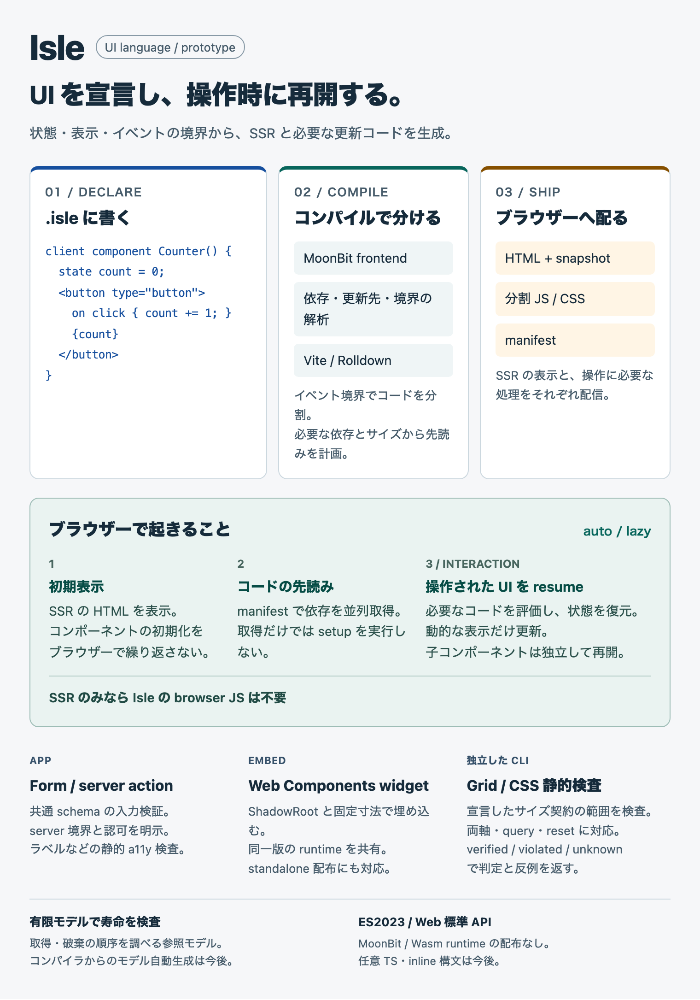

# Isle で何ができるか

Isle は、専用構文から SSR と再開可能な UI を生成する、UI 言語・フレームワークのプロトタイプです。状態・表示・イベント・server action を宣言すると、コンパイラが依存と更新先を解析し、Vite / Rolldown が配信用コードを分割します。



`auto` / `lazy` では、先読みと実行を分けます。取得済みでも setup は操作まで実行せず、対象の状態を復元して動的な表示を更新します。先読みしない場合は操作後に取得します。明示 `eager` は起動時の評価を許す別方針です。

Form、server action、Web Components widget を試せます。Grid / CSS 検査は独立した CLI で、指定されたサイズ・overflow・折り返し等の契約を検査します。認証・認可 policy はホスト側で実装し、有限モデルは独立した参照モデルです。任意 TypeScript、inline 構文、compiler IR からのモデル自動生成は今後の機能です。

[はじめる](../getting-started.md) · [Form](../forms.md) · [widget](../widgets.md) · [CSS 検査と反例](../layout-checking.md) · [図の根拠](facts.md)

[English overview image](figures/isle-overview.en.desktop.png) · [English phone image](figures/isle-overview.en.mobile.png)。root README は [English](../../README.md) / [日本語](../../README.ja.md) を用意し、アプリへ npm パッケージを組み込む視点で説明する。

## 図で使った実行可能な例

<!-- source: counter.isle -->
```text
client component Counter() {
  state count = 0;
  <button type="button">
    on click { count += 1; }
    {count}
  </button>
}
```

<!-- output: overview -->
```text
Counter: compile → SSR 0 → resume 1; one dynamic text patch
```

## 読み取れるか確かめる

<details>
<summary>何がブラウザーへ配られる？</summary>

SSR の HTML、必要な snapshot、分割された JS / CSS、manifest。SSR のみのページには Isle の browser JS を出力しません。

</details>

<details>
<summary>コードが先読みされたら、UI の setup も動く？</summary>

auto / lazy では取得だけでは動きません。操作を受けた対象で評価・復元・setup を行います。明示 eager は別方針です。

</details>

<details>
<summary>CSS の見た目とコンパイラ全体が証明されている？</summary>

CSS 検査は制約付きの契約検査で、判断できない入力は unknown です。有限モデルは参照モデルであり、ブラウザーやコンパイラ全体の証明ではありません。

</details>

## 画像の更新と検証

```sh
just overview-build
just overview-check
just overview-quality
```

画像は HTML / CSS を Playwright で描画した PNG です。デスクトップ版とモバイル版を README の picture で切り替えます。ビルドと検査はコンパイル済み Counter の実行、掲載コードの一致、事実ラベル、横方向のはみ出しを確認します。

explainer の figure-check と verify-doc、vlmkit の integrity / contrast での検査手順と結果は [検証記録](validation.md) に残します。
