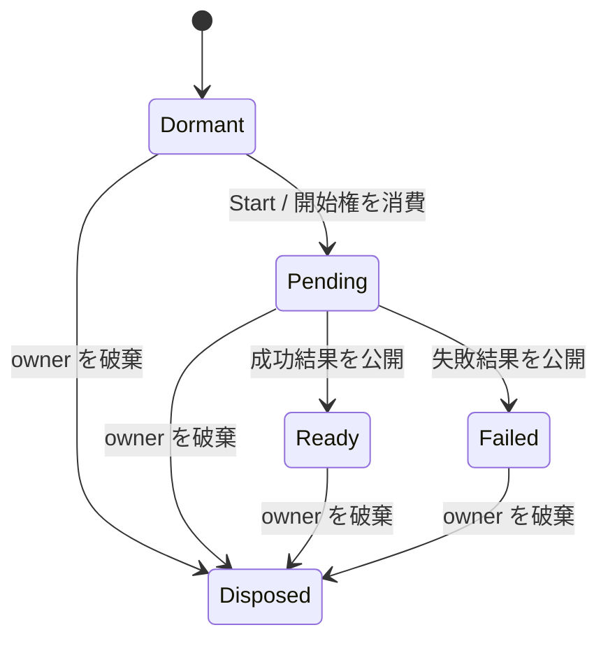

# 時相的な値の意味論とモデル検査

`Once<T>` を「一度だけ読む値」ではなく、同じ resource identity の寿命中に高々一度だけ結果を公開する値とする。読み取りは何度でもよい。公開の結果は `Ready(T)` または `Failed(PublicError)` で、初期化の開始回数、結果の公開回数、component の更新回数を別に扱う。

2026-11-05 時点で、以下の参照モデルと検査は実行できる。所有・破棄カーネルと Vite `resources` から browser の component / widget 寿命への接続も実装した。resource / `Once` / `@pending` の DSL と temporal codegen は未実装であり、このモデルの検査結果をそれらの実装の証明とは扱わない。

## 型をトレースの集合として解釈する

モデルの状態を S、許される遷移を `Next ⊆ S × S` とする。実行は無限列 `σ = s₀,s₁,…` で、初期状態を満たし、各組 `(sᵢ,sᵢ₊₁)` が Next に属する。状態を変えない Tick も許す。待ち続ける実行をモデルから消して、活性が成立したことにはしない。

`Γ ⊢ r : Once<T>@o` の目標となる意味は、owner o に属する r の許される実行が `SpecOnce` を満たすこと。値そのものの型 T、実行側、呼べる RPC と effect の契約は別に検査する。

| 値の分類 | トレースの制約 |
|---|---|
| `Val<T>` | 生存期間中、同じ確定値を読む |
| `Once<T>` | 未確定から終端結果へ高々一度だけ公開し、結果を安定させる |
| `Live<T>` | 宣言した更新に従って結果が変わり得る |

`Once` の安全性だけでは、必ず結果が得られるとは要求しない。処理を開始しない、owner が破棄される、外部処理が永遠に返らない実行を区別する。この文書の Val / Live との型関係は意味論の設計であり、compiler の temporal type checker は未実装。

## resource の状態遷移



完了した外部処理と、その結果の公開を二段階にする。外部処理は先に終わっていても、配送されるまで UI 側は Pending のままでよい。公開時に生存・owner generation・未確定状態を照合する。古い結果は破棄してもよいが、現在の resource の結果を失ってはいけない。

同じ owner generation の Ready / Failed から Dormant には戻らない。再生成は別の identity。現在のモデルは owner の破棄・再生成を First / Second の2世代で表す。同じ owner を残した refresh に必要な resource revision は別軸で、今回のモデルには含めない。

SSR で確定済みの場合は、初期状態を Ready(Seed) にする。SSR で済ませた1回の開始と公開を初期履歴へ織り込み、Resume は初期化を繰り返さない。これは「component の更新回数では SSR 描画を数えない」という規則とは異なる量である。

## 検査する時相性質

G は「常に」、F は「いつか」、W は weak until。g は再利用しない論理 resource identity とする。

| 性質 | 式の例 | 実装した検査 |
|---|---|---|
| 開始は高々1回 | `G(starts_g ≤ 1)` | Safety(start_once) |
| 結果の公開は高々1回 | `G(settlements_g ≤ 1)` | Safety(settle_once) |
| 生きている正しい owner だけへ公開 | `G(publish_g ⇒ alive_g ∧ token_matches_g)` | 違反を記録する monitor に対する Safety(current_owner) |
| 終端結果は破棄まで不変 | `G(ready_g(v) ⇒ (ready_g(v) W disposed_g))` | Safety(terminal_stable)、失敗結果の再初期化も禁止 |
| 読める値を早く捨てない | `G(alive_g ∧ ready_g ⇒ payload_retained_g)` | Safety(retain_readable) |
| Pending は結果または破棄へ進む | `G(pending_g ⇒ F(ready_g ∨ failed_g ∨ disposed_g))` | Response(pending_first, done_first) と second |

一般の LTL parser や任意の式を検査器へ追加したわけではない。veri 0.2.1 の公開 API の `Safety(p)` と `Response(p,q)` を使い、履歴が必要な性質は状態に monitor を加えて検査する。W の式は意図する意味論で、checker へ直接渡す文字列ではない。`Reachability(p)` は存在する実行の到達性 `EF(p)` とし、全実行の `F(p)` と混同しない。

安全性は公平性を付けずに検査する。応答性には次の明示的な弱公平性を付ける。

1. 生存中の現在の owner の処理が Pending で、producer の進行が継続して可能なら、いつか進む。
2. 生存中の現在の owner 向けの完了通知が継続して配送可能なら、いつか配送する。

生きていない owner の、放棄したリクエストの応答まで要求しない。古い成功・失敗が遅れて届く操作自体はモデルに残す。失敗で producer が終了すれば、成功操作を実行する義務は消える。公平性はネットワークやブラウザが実際にこの前提を満たすことの証明ではなく、外部とスケジューラについての仮定である。F は実時間の締切も保証しない。

安全性・活性・弱公平性の区別と stuttering に関する基礎は、Lamport の [Specifying Systems 第8章](https://lamport.azurewebsites.net/tla/book-02-08-08.pdf) を参照。ここでは TLA+ の実装を追加せず、既存の MoonBit / veri で同じ種類の状態遷移を検査している。

## 実行できるモデルと反例

[resource_once/model.mbt](../models/resource_once/model.mbt) は不変の State と純粋な step を持つ。1 resource、owner 2世代、全体で2 tickets、3種類の payload と不正な解放を表す marker に制限する。counter は最初の違反値2で飽和し、wraparound はしない。モデルの状態は Ready / Failed / Disposed 後も Tick や Read で無限実行を表せる。

| 検査 | 機械実行の結果 |
|---|---|
| Strict / cold | 到達可能126状態で5つの安全性を確認 |
| Strict / SSR ready | 到達可能22状態で5つの安全性を確認 |
| 生存している各 generation の応答性 | 明示した公平性の下で反例なし |
| 二重開始を許す | `Resume → Start → Start` |
| 二重公開を許す | `Resume → Start → Succeed0 → Publish0 → Publish0` |
| generation guard を省く | First の完了を、再生成後の Second へ公開する反例 |
| disposal guard を省く | `… → Dispose → Publish0` |
| SSR ready を再初期化する | `Resume` で終端状態を壊す反例 |
| continuation と一緒に readable value を解放する | 公開後の ReleaseContinuation で retain_readable に違反 |
| 公平性なし | `Resume → Start → (Tick)∞` |
| producer だけ公平 | 外部処理が終わった後、配送せず `(Tick)∞` |
| 完了通知を失う | 公平性があっても Pending に留まる循環反例 |

反例は単なる状態の JSON ではなく、veri の `Client.accepts` により同じ `step` / `holds` で再生する。応答性の反例は prefix と閉じた loop を持つ lasso。検査時と再生時に同じ公平性を明示的に渡す。モデルが提案する justice は API に自動適用されない。

`resource_once/pair.mbt` は独立する2個の Once を4状態で扱う。各値は1回だけ公開されるが、`LeftCompletes → RightCompletes` では component が2 transaction 更新される。したがって「すべて Once 値だから component 全体も once」という推論は成立しない。このモデルは別 transaction で配送される実行を許しており、常に batching 不可能という主張ではない。

```sh
moon test models/resource_once --target js --deny-warn
just verify
```

[formal.json](../evals/results/formal.json) の report v2 は、破棄・CSS 解決モデルを含む92ケースを検査する。応答性16ケースは9つの循環反例と7つの成立を期待する。全35反例の内訳は、故障版29件、仮定を外した検査4件、不十分な契約の検査2件。反例の存在が想定されるケースも含め、期待した結果と再生が一致したときだけ全体が成功する。全拒否のモデルを避けるため、成功・失敗・破棄・次世代での成功の到達性も検査する。

探索の depth / states 上限で打ち切られた場合はエラーにする。完了した有限グラフに対する SCC と公平性の検査なので、そのグラフの無限経路を対象にする。深さ40まで反例がなかった、という上限付き活性検査とは区別する。ただし、任意の値・任意数の owner / resource・無制限の再試行についての定理ではない。

## codegen の最適化へ接続する条件

将来の source / IR の意味保存の目標は、内部の準備手順を隠した観測について `Traces(optimized) ⊆ Spec(source)` とする。最適化の都合で無限に内部処理だけを続ける実装を許さないよう、応答性と公平性の対応も必要。G / F / W を使うのは、内部手順の数を固定する X に依存しない仕様にするためである。

| 最適化 | 必要な検査 |
|---|---|
| 終端後に完了用 continuation を解放 | 再公開しない。将来読む payload は保持する |
| SSR ready から init chunk を除去 | Resume が新しい Start を発行しない |
| 一度だけ確定する binding を追跡対象から外す | その binding の他の依存が Live ではない |
| component 全体の更新情報を解放 | 独立 resource、子 owner、今後の event / factory の consumer が残らない |
| 複数処理の batching | 観測する結果と effect の順序を保ち、終端への到達を失わない |

モデルから compiler / generated JS への refinement mapping と、その意味保存証明は未実装。破棄カーネルにはモデル由来の schedule を Node で再生し、component / widget の自動接続は browser E2E で別に検査する。Once の UI 公開・`@pending` を含む resource DSL 全体の検証ではない。

再試行、同じ owner 内での refresh、streaming SSR の完了配送、timeout、複数 observer の保持解析、RPC の認可や外部副作用の exactly-once は追加のモデルが必要。型だけでネットワークの完了や外部 mutation の高々一回実行を保証したとは扱わない。

所有する生リソースの終了処理は [unmount とリソース破棄](resource-disposal.md)へ拡張した。Once の確定と解放責任は別の契約で、破棄カーネル・モデル由来の schedule 再生・component 寿命との自動接続を実装している。専用 DSL / temporal codegen は未実装。
