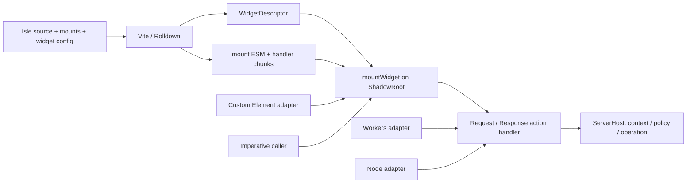
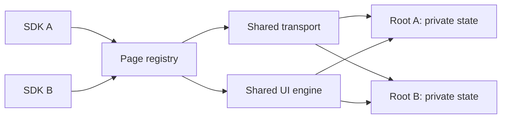

# Widget の共通設計

widget をビルド成果物、root への mount、公開方法に分ける。アプリのデータ・CSS・認可、Custom Element の接続 lifecycle、HTTP 配信基盤を互いに依存させない。



| 層 | 公開契約 | 責務 |
|---|---|---|
| wire | [`WidgetDescriptor`](../runtime/widget-contract.d.mts) | runtime の版と配布モード、HTML、module、preload、action directory。検査と URL 解決は DOM に依存しない |
| build | [`IsleOptions.widget`](../lib/vite.d.mts) | 同じ IR と SSR renderer から descriptor / loader / mount ESM を生成 |
| mount | [`mountWidget()` / `WidgetModule`](../runtime/widget-mount.d.mts) | 配置、コード準備、resume controller、キャンセルと所有権 |
| element | [`defineWidget()`](../runtime/widget.d.mts) | visibility、必須寸法、接続・切断、ready / error 通知 |
| embed | [`renderWidgetEmbed()`](../lib/widget.d.mts) | 初期サイズ予約、ラベル、source と loader、任意のタグ名 |
| HTTP | [`createActionHandler()`](../lib/server.d.mts) | 共通 routing / CORS と入力検証、認証・認可・operation の呼び出し |
| hosting | [`createWorkerHandler()`](../lib/worker.d.mts) | RPC と ASSETS の振り分け。Cloudflare 固有の binding をここだけで扱う |

MoonBit frontend、ProgramIR、snapshot v2、CodeRef、handler の位置引数 ABI は変更しない。例が benchmark のデータを使っても、共通 lib/ / runtime/ は dashboard のモデルを import しない。

## Vite から直接生成する

```ts
isle({
  entry: '/project/app.isle',
  mounts: [{ component: 'Counter', props: { initial: 17 }, label: 'Counter' }],
  loading: 'eager',
  widget: {
    runtime: 'shared', // default。独立した runtime は 'standalone'
    tagName: 'demo-counter',
    descriptorFile: 'components/counter.json',
    loaderFile: 'sdk/counter.js',
    actionBaseURL: '../api/actions/',
    template: '<main><h1>Counter</h1><!--isle:ssr--></main>',
    css: 'main{font:16px system-ui;padding:24px}',
  },
});
```

template は `<!--isle:ssr-->` を一つ含む trusted fragment、CSS は native Shadow DOM 用に明示して書く。ページと widget は同じ SSR renderer を使い、label は escape する。生成後の document の切り出し、script 削除、body / :root selector の書き換えは行わない。

Vite plugin が loader と mount module を chunk として登録するため、アプリごとの app.mjs / embed.mjs や追加 entry 設定は不要。descriptor の module / preload は Vite の page base に依存しない相対 URL として出力し、配信先の prefix へ移動できる。

## 配置と wire 契約

```json
{
  "version": 2,
  "runtime": { "version": "0.0.1", "mode": "shared" },
  "html": "<main>…SSR and inert snapshots…</main>",
  "module": "../assets/isle-widget-mount-HASH.js",
  "preload": ["../assets/isle-resume-HASH.js"],
  "actions": "../api/actions/"
}
```

相対 URL は descriptor 自身を基準に解決する。`/package/components/counter.json` の `../api/actions/` は `/package/api/actions/` になる。module / preload は同一 provider に限定する。actions は別の HTTP(S) API origin も明示でき、その API が publisher に対する CORS と認可を担当する。action directory の query / fragment は拒否する。

wire の `version: 2` と runtime の release version は別の値。runtime の版・配布モードが SDK と完全一致しない descriptor は、HTML の展開・preload・module import より前に拒否する。runtime 情報のない v1 descriptor も拒否する。読み込んだ mount module の `runtimeIdentity` も、`mount()` を呼ぶ前に照合する。native import の module 評価自体はこの照合より先に起こるため、trusted compiler output を前提とする。

actions 省略時は `./__isle/`。`module: null` は静的出力で、その場合 preload は空に限定する。静的 widget は Custom Element の表示用 transport だけを使い、UI runtime、handler、snapshot を出力・取得しない。通常の SSR ページは browser JS なしの出力を維持する。

```ts
renderWidgetEmbed({
  descriptorURL: 'https://cdn.example/package/components/counter.json',
  loaderURL: 'https://cdn.example/package/sdk/counter.js',
  tagName: 'demo-counter', // loader が登録する名前と一致させる
  href: 'https://cdn.example/package/',
  title: 'Counter', width: 320, height: 280,
});
```

`src: 'https://provider.example/'` は widget.json / widget.js を使う互換用の短縮形。明示的 descriptor と同時には指定しない。同じ Window でタグ名が競合するアプリや版には、異なる tagName を使う。

## 複数 SDK の共有ランタイム

`runtime: 'shared'` が既定値。埋め込み SDK は小さい bootstrap とし、同じ JavaScript realm（通常は一つの Window）の `Symbol.for('isle.runtime.registry/1')` を使う。最初の SDK が runtime の版を固定し、配信 origin や URL が違っても、同じ版・ABI の読み込み Promise と実装を一つにする。



- `isle/widget/3` は Custom Element / imperative mount の transport。descriptor-relative な CSS と `preloadStyles`、eager CSS の準備に対応する。descriptor の wire version は2のまま。
- `isle/client/8:debug=0:profile=0` は loader / resume / Form / 入れ子の owner 管理、閉じた構造化値、region commit bridge、resource setup と自動破棄、CSS-ready の適用ゲートと同期イベントキャンセルを持つ UI エンジン。共有 widget ビルドは機能一式を含め、最初の小さなアプリの機能削減を他のアプリへ持ち込まない。
- state、registry、action transport、event listener は root ごとに分離する。一つの close は別 root や共通エンジンを閉じない。
- 版は文字列の完全一致。semver range は使わず、patch の違いも拒否する。同じ family の ABI、diagnostics / profile の異なる variant も拒否する。SDK は vendor の取得・タグ定義より前に必要な版・ABI をまとめて確保する。
- 不一致はその SDK の初期化を失敗させる。すでに動いている widget は維持し、別 runtime への自動切り替えは行わない。
- vendor の版・ABI・必須 export を検査する。初期化に失敗した entry は破棄して同じ版で再試行できるが、ページの版・ABI の固定は解除しない。古い registry protocol も拒否する。同じ Symbol key を維持し、非対応 SDK と別 pool を作って併走しない。

共有 vendor は factory が選ばれたときにだけ import する。manifest の eager preload で全 provider の vendor を先取りしない。SDK の bootstrap、app 固有 module、descriptor の取得自体が全て一つになるという意味ではない。

```ts
import { sharedRuntimeInfo } from 'https://provider.example/widget.js';
console.table(sharedRuntimeInfo()); // version / ABI / loading・ready の snapshot
```

14 root の同時 mount と、同じ版の異なるビルドを組み合わせた Form 操作でも transport / UI エンジンをそれぞれ一回だけ取得・評価した。[共有ランタイムの評価](../evals/reports/shared-runtime.md)を参照。通常の widget を有効にしないページは従来の capability 別 tree shaking を維持する。static descriptor は UI エンジンを取得しない。

## standalone 配布

```ts
isle({
  entry, mounts,
  widget: { runtime: 'standalone', tagName: 'my-counter-v2' },
});
```

standalone SDK は自身の transport / UI runtime を使い、共有 registry を参照・作成しない。共有版とは異なる版でも同じページへ配置できる。機能別の tree shaking を使い、Vite / Rolldown のコード分割と manifest による並列取得を維持する。配布ディレクトリと必要な API を配信する形であり、単一ファイル化やオフライン実行の指定ではない。

既定のタグ名は shared が `isle-widget`、standalone が `isle-widget-standalone`。Custom Element registry は Window ごとに一つなので、異なる版の standalone もそれぞれ別のタグ名でビルドする。同名の定義に版・配布モードの不一致があれば拒否する。命令的な `mountWidget()` でも SDK の import はタグを定義する。

runtime の版は `package.json.version` が既定値。配布版を指定する場合は `widget.runtimeVersion` に正確な版を設定する。これは同じ版を名乗る任意の改変コードの同一性を保証する hash ではない。ビルドごとに同じ配布版の実装・ABI を揃える。版の fixture は `0.0.1-fixture` のように明示する。

埋め込み helper の `runtime: 'standalone'` は既定のタグ名を選ぶ。URL の切り替えは caller が行う。

```ts
renderWidgetEmbed({
  src: 'https://provider.example/standalone/', runtime: 'standalone',
  title: 'Counter', width: 320, height: 280,
});
```

現在の評価は[版の固定と standalone 配布](../evals/reports/runtime-distributions.md)を参照。

## 命令的な mount と所有権

```ts
import { mountWidget } from 'https://cdn.example/package/sdk/counter.js';
const abort = new AbortController();
const controller = await mountWidget(
  container.attachShadow({ mode: 'open' }),
  'https://cdn.example/package/components/counter.json',
  { signal: abort.signal, onError: console.error },
);
await controller.settled();
controller.close(); // または abort.abort()
```

寸法と配置は caller が管理する。同じ root には同時に一つだけ mount でき、二重 mount は DOM を書き換える前に拒否する。root 上の Symbol に所有権を記録し、異なる版の standalone と共有版の間でも検査する。これは runtime の共有ではない。close は idempotent で、SSR DOM を残して listener / runtime の所有権を解放する。close 後は同じ root へ再度 mount できる。

Abort は未完了の mount の所有権も即座に解放する。native import は停止できないため、await 後にも signal を検査し、古い処理が新しい mount へ書き込まないようにする。Custom Element は同じ mount を使い、実際の切断時に abort、同期 DOM 移動では接続を保持する。

## HTTP と配信基盤

```ts
const handle = createActionHandler(contracts, host, {
  actionBasePath: '/package/api/actions/',
  allowedOrigins: ['https://publisher.example'],
});
// Node / edge adapter で Request を渡し、返された Response を配信する。
```

path / method / Origin / CORS preflight は共通 HTTP envelope、schema / policy / operation は server executor に分けた。Workers と Node は同じ handler を使う。既定 path は `/__isle/`、Origin の既定値は同一 origin 限定。公開デモの `'*'` は明示設定で、cross-origin Cookie / Authorization は拒否する。

Shadow DOM は JS の権限境界にはしない。trusted template / CSS / compiler output を前提とし、任意 HTML の sanitizer は提供しない。認証・永続化は ServerHost の責務であり、origin list で代替しない。

[`examples/portable-widget/`](../examples/portable-widget/vite.config.mjs) は別アプリの Counter / Editor と static Notice を、Node の /portable/ 以下から配信する。同じ plugin 設定でカスタムタグ、nested descriptor、SDK、独自 RPC path を使い、Custom Element と imperative mount の両方を検証する。

```sh
just widget-check        # Workers + 複数 origin の Node SDK、unit、16 E2E
just widget-portable-dev # http://127.0.0.1:8793/portable/
just ci                  # 共通 compiler / runtime / models / a11y
```

[Workers の利用手順](worker-widget.md)、[一般化の評価](../evals/reports/widget-refactor.md)も参照。
