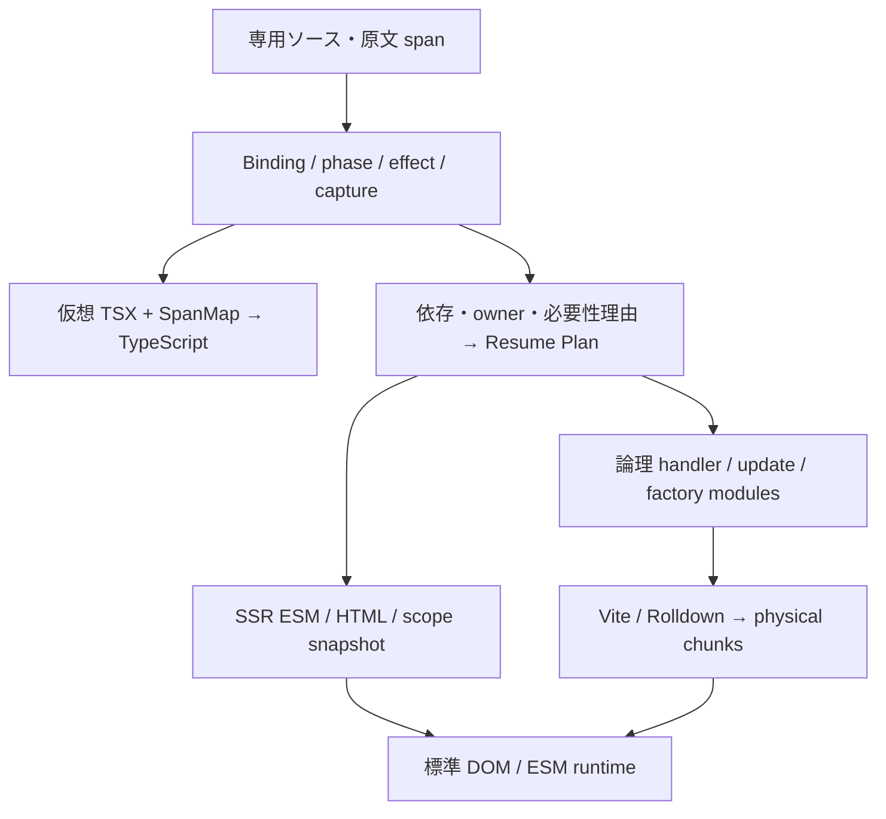

# 最新の UI 技術から resume 言語を設計する

2026-11-02 時点の一次資料を基に、既存の初期設計を見直した。**採用価値が高いのは、共通の必要性解析、scope の所有権、更新の commit 境界、遅延イベントの能力制限、生成物を説明する仕組みである。** 細粒度 DOM 更新やコンパイラの存在だけでは、起動・初回操作・非同期処理の正しさまでは決まらない。専用文法は、保存する状態、純粋な導出、再開する処理、許可する副作用を明示するために使う。Vite／Rolldown へ分割可能な ESM を出し、型診断は Content Mapper に委ねつつ、保存可能性などの独自保証は別に定義する。Web 標準は安定した DOM／ESM／HTML を基盤にし、新しい API は機能の有無と意味の差を閉じ込める adapter として扱う。本稿の採否は設計提案であり、実装・テスト・性能測定は行っていない。自己完結した仕様案は [設計書](../docs/design.md) に分離した。

## 直接 DOM の生成に加え、必要性と寿命の解析を取り入れる

今回の目的に最も近い比較対象は Qwik と Marko 6 である。Qwik は SSR の結果から再開し、component の初期実行をブラウザで繰り返さない。調査時点では stable 1.20.3 と v2 RC 系が並行しており、README の beta 表記と実際の release 表記に差がある。v1 の API と v2 の状態復元を混ぜずに扱う必要がある。Marko の実装資料は一つの依存グラフから、client に残す module、SSR scope payload、DOM range marker、遅延起動処理を対応させて生成する構造を説明している。**本設計も、コードと snapshot を別々に小さくするのでなく、将来の操作に必要なものを同時に求める。** ([Qwik releases](https://github.com/QwikDev/qwik/releases)、[Marko resumability architecture](https://github.com/marko-js/marko/blob/main/packages/runtime-tags/RESUMABILITY.md))

Marko の `reasons.ts` では、state や parameter に由来する必要性を伝播させる。ここから取り入れるのは、必要・不要の boolean だけでなく、**なぜ値・helper・marker が残ったかという原因を保持する**設計である。`explain` に handler の capture、state から更新先への経路、保存 field、論理 module を表示すれば、ユーザーが懸念する変換の運用難に直接応えられる。後に bundler の出力と結び付けられる ID を持たせるが、圧縮後の byte は非加算的なので、symbol ごとの厳密な gzip 費用を初期機能として約束しない。([Marko reasons.ts](https://github.com/marko-js/marko/blob/main/packages/runtime-tags/src/translator/util/reasons.ts))

他の現行実装も、「compiler があればすべて静的になる」という見方を支持しない。Svelte 5 の derived／effect は実行時に同期 read を追跡する。Vue Vapor は VDOM を介さない DOM 操作と effect を生成するが、VDOM 互換を使うとその runtime が戻る。React Compiler 1.0 は React の意味論を保つ自動 memoization を選び、非対応 pattern を診断して対象を skip する。本言語ではユーザーが制約を許容しているため、未知の dependency や capture を暗黙の動的経路へ逃がさず、原文位置付きで拒否する選択を採れる。これは既存 framework より一般的に優れるという主張ではなく、互換性に対する設計上の優先順位である。([Svelte derived](https://svelte.dev/docs/svelte/$derived)、[Vue Vapor RC](https://github.com/vuejs/core/releases/tag/v3.6.0-rc.1)、[React Compiler 1.0](https://react.dev/blog/2025/10/07/react-compiler-1))

安定性も区別する。Vue stable は3.5.44、Vapor は3.6 RC 系を確認した。Solid 2 は RC であり、Promise を graph に統合し、compute と apply を分ける新しい model を提示する。Svelte の await 式は現行資料で experimental flag を要する。これらから更新段階や async consistency の問題を学べるが、その API を確定した標準として移植する理由にはならない。Angular の incremental hydration が準備前イベントを queue する点、Astro が static HTML と明示的な interactive boundary を分ける点も参考になる。ただし hydration、別 endpoint の server island、resume は異なる実行方式である。([Vue releases](https://github.com/vuejs/core/releases)、[Solid 2 RC](https://github.com/solidjs/solid/discussions/2995)、[Svelte await](https://svelte.dev/docs/svelte/await-expressions)、[Angular incremental hydration](https://angular.dev/guide/incremental-hydration)、[Astro islands](https://docs.astro.build/en/concepts/islands/))

scope の寿命は値の依存グラフと分ける。Solid の root は dispose されるまで computation を保ち、Svelte の effect 実装も親子 effect、DOM range、teardown を管理する。本設計では owner が state、DOM range、listener、effect、pending dispatch、resource を所有し、削除時に一度だけ破棄する。keyed reorder は同じ owner を移動し、remove は owner を破棄する。静的な template location と動的 instance ID を混同しない。([Solid createRoot](https://docs.solidjs.com/reference/reactive-utilities/create-root)、[Svelte effects implementation](https://github.com/sveltejs/svelte/blob/main/packages/svelte/src/internal/client/reactivity/effects.js))

## 研究から借りるのは、小さい意味論と不変条件である

専用文法の `state`、`derive`、`on` は、実行時期を決めるための入口になる。段階分離の研究は、早期に利用できる値と後段へ残す計算を区別する基礎を与える。本設計では build、SSR request、client event、client effect の phase を独立した解析結果にする。**SSR で一度実行する state 初期化は、build 時に結果が決まる定数計算とは異なる。** SSR の時刻や request data から得た保存可能な値を渡すことと、server-only な DB handle や認証 capability を渡すことも区別する。([Davies／Pfenning, A Modal Analysis of Staged Computation](https://www.cs.cmu.edu/~fp/papers/jacm00.pdf))

closure conversion と defunctionalization の考え方は、handler を symbol と環境の対応へ変換する設計に使える。capture を不変の保存値、共有 state への参照、import 可能な symbol に分類し、DOM node や任意 closure の生オブジェクトを snapshot に入れない。全 handler を一つの巨大 switch にする必要はなく、ESM export と capture layout を契約にすればよい。論文自体が Web の closure serialization やコード分割を提供するわけではない。([Danvy／Nielsen, Defunctionalization at Work](https://tidsskrift.dk/brics/article/view/21684))

静的増分化の研究は、入力差分から出力差分を導くための primitive ごとの契約を示す。初期設計では、state write に対応する dirty binding と構造更新までに適用範囲を絞る。任意の TypeScript の `filter`、`sort`、外部 helper を自動で漸近高速化する約束はしない。pure derive を静的順序で評価し、DOM commit 後に外部 effect を実行する。同期 diamond の途中値を描画しないことを意味論にし、安い計算は再計算、大きなデータ変換の差分化は後続の最適化とする。([Cai ほか, A Theory of Changes for Higher-Order Languages](https://arxiv.org/abs/1312.0658))

effect は要求 capability として分類できる。DOM、network、clock、random、storage を pure derive から分離する。ただし必要 capability が分かることは、決定性、例外や発散の不在を証明することではない。実装言語が Rust、MoonBit、effect-typed な vibe のいずれでも、埋め込んだ TS の純粋性が自動で保証されることはない。初期版は一般的な effect polymorphism を目指さず、解析可能な演算と helper、明示的な信頼境界に閉じる。([Brachthäuser ほか, Effects as Capabilities](https://ps.informatik.uni-tuebingen.de/publications/brachthaeuser20effekt.pdf))

2026年10月公開の Async RaTT 拡張版は、実行中に変わる入力依存集合にも静的上限を設け、非同期計算の causality、productivity、space leak を扱う。本設計へ移すのは型体系全体でなく、scope generation と結果の適用条件である。宣言的 resource は開始時の `(ownerGeneration, resourceKey, requestRevision)` を持ち、生存中の owner と当該 resource の最新 revision に一致するときだけ commit する。通常の event action や外部 mutation は別の順序規則を持ち、すべてを global latest-wins にしない。abort は仕事の停止要求に使うが、古い結果の拒否は token の検証でも保証する。generation を加えただけで論文の形式保証が得られるとは主張しない。([Bahr／Møgelberg, Asynchronous modal FRP](https://jfp.episciences.org/en/articles/17791))

## Web 標準は JS を減らす基盤と、任意の最適化に分ける

最初に採るべきものは標準 HTML の動作である。dialog、popover、form、Invoker Commands を作者が選べば、開閉のためだけの handler や state を要求せずに済む。compiler が任意の state を native open state に自動変換することは避ける。CSS containment や content-visibility も、layout の意味や DOM の保持と関係するため作者の opt-in にする。専用文法を増やして標準要素を包むより、必要な JS がないことを到達性解析で確認して client 生成物を消す構成がよい。([HTML button commands](https://html.spec.whatwg.org/multipage/form-elements.html#attr-button-command)、[CSS Containment 2](https://www.w3.org/TR/css-contain-2/#content-visibility))

新しい標準を使う際は、標準化と実装範囲を分ける。`moveBefore()` は DOM 標準にあり keyed reorder に有用だが、調査時点で Safari は未対応である。`insertBefore` への fallback で node identity は保てても、focus、iframe、media、custom element の状態まで同等とは言えない。Scheduler API も任意 adapter に留め、優先度や task 順の違いが正しさを変えない契約にする。Shadow DOM は相互運用 backend として扱い、document delegation がすべての event root に通用するとは仮定しない。([DOM moveBefore](https://dom.spec.whatwg.org/#dom-parentnode-movebefore)、[対応状況](https://web-platform-dx.github.io/web-features-explorer/features/move-before/)、[Scheduling APIs](https://wicg.github.io/scheduling-apis/))

|対象|確認した状態|今回の採否と設計への影響|
|---|---|---|
|標準 HTML／CSS／ESM|利用可能な基盤|採用。native の動作を保ち、不要な JS を生成しない|
|BFCache／page lifecycle|DOM と JS heap が保持・再開される|core の正しさ要件。snapshot 再初期化と dispatcher の二重起動を禁止|
|modulepreload|ESM の取得・parse／compile を先行できる|任意 policy。全 handler を無条件 preload しない|
|moveBefore／Scheduler|標準・draft と実装範囲に差がある|capability adapter。fallback の意味差を明記|
|Trusted Types|現行主要エンジンへ実装が拡大|出力契約へ反映。HTML sink を使う backend は host policy と適合させる|
|`<template for>`|HTML Living Standard に規定、現行 Blink 実装のみ|native streaming backend を保留。scope ownership の受け渡しを先に設計|
|`streamHTML` 等|参照仕様は提案、現行 stable 全未対応|必須依存にしない|
|TC39 Signals|Stage 1|core の graph を提案 API に固定しない|
|DOM Parts／Template Instantiation|提案・draft|locator／range の内部契約だけを保持|

BFCache 復帰は新しい document の起動ではない。bootstrap は document ごとに冪等にし、`pageshow.persisted` では既存 state と DOM を保持する。必要な外部接続だけを再接続し、`pagehide` を一律に owner 破棄とみなさない。出力では外部 ESM と data-only snapshot を基本にし、通常 binding は text／property API を使う。新規 block は直接 DOM を作る factory を基線にし、HTML sink を使う高速 backend を設ける場合は Trusted Types の policy と escaping の責任を別途定義する。JSON を評価しなくても、HTML 内 script data の終端条件への対応は必要である。([BFCache](https://web.dev/articles/bfcache)、[Trusted Types](https://www.w3.org/TR/trusted-types/)、[HTML script contents](https://html.spec.whatwg.org/multipage/scripting.html#restrictions-for-contents-of-script-elements))

native streaming は将来有望だが、今すぐ backend を交換できるものではない。`<template for>` は標準本文にあり Chrome／Edge 150 に実装される一方、Firefox／Safari は未対応である。別 API 群の streaming setters は現行互換性データで全 stable 未対応だ。parser による置換の前後で、旧 owner の cleanup、新 snapshot の公開、pending event の無効化、client 更新との競合を解決する必要がある。Marko の実験的 Patch Protocol も、JavaScript 評価と `unsafe-eval` を要する現行 wire を移植せず、state や focus を保つ目的だけを参考にする。([HTML template for](https://html.spec.whatwg.org/multipage/scripting.html#attr-template-for)、[template-for 対応](https://web-platform-dx.github.io/web-features-explorer/features/template-for/)、[streaming setters 対応](https://web-platform-dx.github.io/web-features-explorer/features/html-streaming-setters/)、[Marko Patch Protocol](https://markojs.com/docs/explanation/patch-protocol))

Signals は Stage 1、DOM Parts と Template Instantiation は提案段階であり、resume の保存形式や所有権を自動的に解決しない。将来 adapter を追加できる IR の分離は保つが、これらの成立を待つ必要はない。Navigation／View Transitions も router の任意機能にし、標準リンク、MPA、BFCache で成立する core を優先する。([TC39 Signals](https://github.com/tc39/proposal-signals)、[DOM Parts](https://github.com/WICG/webcomponents/blob/gh-pages/proposals/DOM-Parts.md)、[Template Instantiation](https://github.com/WICG/webcomponents/blob/gh-pages/proposals/Template-Instantiation.md)、[Navigation API](https://html.spec.whatwg.org/multipage/nav-history-apis.html#navigation-api))

## 型投影とチャンク分割の境界を明確にする

初期案から最も明確にすべき点は型検査の保証範囲である。TypeScript 7.1 Beta の Content Mapper は仮想 TS／TSX と原文への mapping を返し、埋め込み式の診断や editor 機能を TypeScript に処理させられる。しかし、**TypeScript の型情報を compiler core へ自動的に還流させる機構ではない。** Oxc semantic も束縛と scope の解析であり、完全な TS 型検査器ではない。型投影、独自の phase／effect／capture 解析、SSR 時の codec 検証を三つの責務に分ける必要がある。([TypeScript 7.1 Beta](https://devblogs.microsoft.com/typescript/announcing-typescript-7-1-beta/)、[Content Mapper host](https://github.com/microsoft/TypeScript/blob/main/tsc/internal/contentmapper/host.go)、[Oxc semantic](https://docs.rs/oxc_semantic/latest/oxc_semantic/))

state の schema は compiler が理解する閉じた shape から始める。外部 alias、`any`／`unknown`、任意 class を型注釈だけで保存可能と認めない。実行時の request data には encode 時の検証を残す。有限 number、`-0`、undefined、循環や共有 alias などの扱いを codec の仕様に書き、JSON.stringify の暗黙変換へ意味論を委ねない。一般の TS 型問い合わせが必要になれば、その連携を独立して設計する。これは型安全性を諦める提案ではなく、それぞれが実際に保証できる範囲を限定する判断である。

型ビューは元の式と型構文を保持した解析モデルから分岐させ、DOM 最適化後の IR から逆算しない。SpanMap は通常の debugger source map と異なり、verbatim／atom／alias などの対応を持ち、edit には厳密な位置対応が必要になる。独自診断と TS 診断は原文上で合流し、runtime source map は別 artifact にする。Beta の compiler／editor の組合せと mapper 許可は、将来の実ホスト検証項目として残す。([TypeScript mapper round 2](https://github.com/microsoft/TypeScript/pull/63936)、[SpanMap implementation](https://github.com/microsoft/TypeScript/blob/main/tsc/internal/spanmap/spanmap.go)、[vize Content Mapper](https://vizejs.dev/guide/content-mapper/index.html))

チャンク分割では compiler の責務が想像より大きい。Rolldown は一つの module 内を分割しないため、巨大な generated module に handler をまとめ、後から symbol ごとの分割を期待してはならない。compiler が handler／update／factory を必要な粒度の virtual submodule に抽出し、route／entry 局所 registry に literal `import()` を生成する。snapshot の論理 ID、registry、bundler が決める URL という経路を固定し、物理 grouping や共有 chunk は Rolldown に委ねる。1 handler＝1 chunk は ABI に含めない。([Rolldown manual splitting](https://rolldown.rs/in-depth/manual-code-splitting)、[Vite Plugin API](https://vite.dev/guide/api-plugin))

dev では通常の出力生成 hook が走らないため、loader を production の `generateBundle` だけに依存させない。client、SSR、型ビューは同じ schema を参照しつつ、target ごとに生成 cache を分ける。source、依存する signature／effect summary、compiler options、schema revision を入力 identity に含める。Vite Environment API は RC で個別 experimental API もあり、host adapter に閉じて対応範囲を固定する。capture schema が変わる HMR は full reload を基本とし、state migration は別課題にする。([Vite Environment API](https://vite.dev/guide/api-environment-frameworks)、[Environment API for Plugins](https://vite.dev/guide/api-environment-plugins))

## 実装前に、再開の正しさと測定対象を固定する

設計の全体像は、原文の binding と span を共有し、型投影と実行計画を分岐させる構成である。FS、resolve、stdio、watch、Vite 接続を compiler core の外へ出し、SSR の request／stream host も adapter に隔離する。Rust＋Oxc は解析資産の再利用から暫定第一候補だが、MoonBit＋ts.mbt や vibe との比較は同じ artifact 契約で行う。実装言語だけから生成 UI の性能順位を決めない。

イベントについては、遅延 dispatch を元の browser event の再現と呼ばない。`dispatchEvent()` による event は trusted にならず、元の dispatch 終了後に currentTarget や event path をそのまま使う契約も成立しない。loader は必要な値と target／scope identity を取得し、default 抑止は同期 metadata として処理する。user activation、drag data、動的な同期 cancel が必要な処理は eager／sync entry に限定し、イベント前に登録済みで同期 call できる静的な code edge を用意する。`import()` は先読み済みでも非同期なので、prefetch だけで同期能力を保証しない。その分の code／boot 費用は計上する。form では接続時の live value と selection を SSR 値で巻き戻さない。([DOM dispatch](https://dom.spec.whatwg.org/#concept-event-dispatch)、[HTML user activation](https://html.spec.whatwg.org/multipage/interaction.html#tracking-user-activation)、[HTML input value](https://html.spec.whatwg.org/multipage/input.html#dom-input-value))

将来の TDD は、別 browser realm での真の resume、共有 cell の参照保持、二 instance の分離、同期 diamond の commit、破棄済み scope への遅延 import／resource 結果、独立 resource の並行完了、未準備期間のフォーム入力、BFCache 復帰、原文診断、実際の Vite production graph を受入対象にする。現段階では fixture やテストコードを作らず、意味論と失敗条件を文書に残す。

性能評価は総 byte と cold path を分ける。HTML、snapshot、marker、bootstrap、必要 chunk、CSS を同じ圧縮条件で数え、HTTP cache、module cache、prefetch の条件も分離する。INP は入力から次の描画を観測する指標であり、非同期 import 後の操作完了をすべて表すわけではない。event→module ready→state commit→DOM commit の semantic completion を併記し、軽い feedback だけを先に出して操作完了の遅れを隠さない。([Event Timing](https://www.w3.org/TR/event-timing/)、[INP](https://web.dev/articles/inp))

今決めるべき境界は、closed state shape、capture の参照表現、commit の観測可能な順序、owner の破棄、event の能力である。これらを先に言語の意味論へ置けば、新しい標準の実装や backend が増えても core を保てる。最小 browser 対応範囲、codec の厳密な集合、effect／resource の構文、実装言語、streaming の所有権移譲は未確定であり、追加の設計判断として残す。
