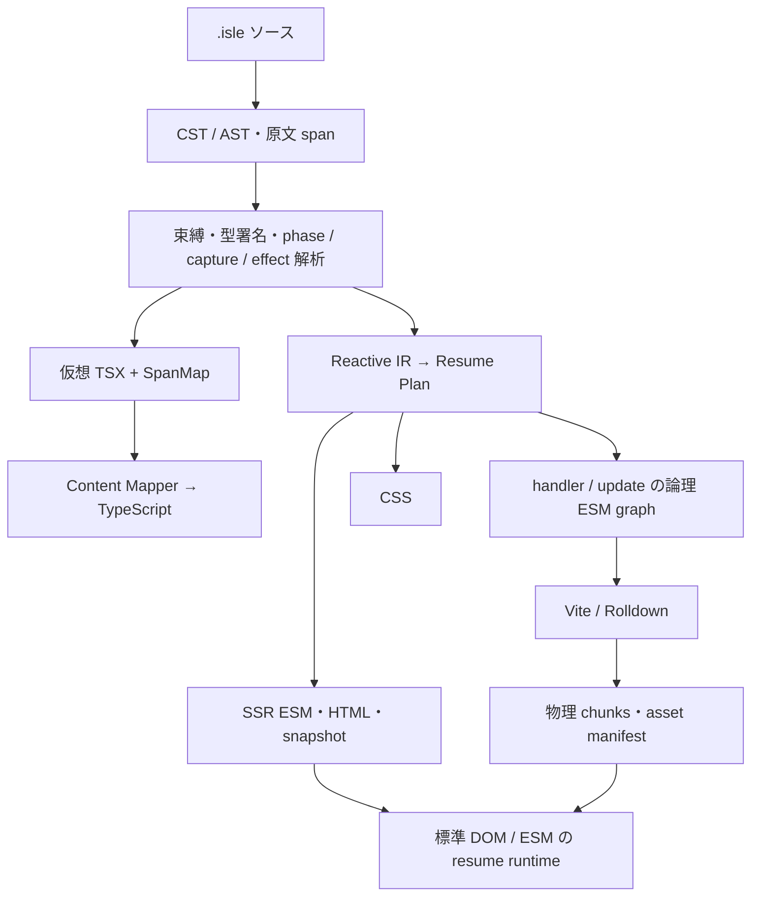

# 専用文法から resume する UI を作る

2026-11-02 時点の初期設計案。**resume を言語の意味論として定義し、状態・導出・イベントを専用構文で区別するコンパイラ**を作る構成を推す。SSR が確定した値と DOM を引き継ぎ、ブラウザで component の setup や初期 render を再実行しない。依存関係と更新手順はコンパイル時に決め、ユーザー入力や可変長リストの実際の値・個数は実行時に扱う。型検査は Content Mapper 経由で TypeScript に委ね、こちらは phase・capture・effect・DOM 更新を解析する。Vite／Rolldown を第一級のビルド対象とし、生成アプリは標準 ESM／DOM、コンパイラと SSR はホスト依存を分離する。実装言語は Rust＋Oxc を暫定の第一候補とするが、ブラウザの生成コードと resume 契約を固定すれば MoonBit／vibe への変更は切り離せる。以下の構文と ABI は提案であり、実装・性能測定はまだない。

## `$` の変換規約を状態・計算・再開処理の文法にする

Qwik は SSR 時にイベントの symbol や状態を記録し、ブラウザでアプリ全体を実行せず再開する。Optimizer は `$` を境界として処理を import 可能な symbol に抽出する。引き継ぐべき中心はこの server／client 間の継続である。今回は変換境界を専用文法と診断で見えるようにする。([Qwik resumability](https://qwik.dev/docs/concepts/resumable/)、[Optimizer](https://qwik.dev/docs/advanced/optimizer/))

最小の文法は次の形で試せる。拡張子を仮に `.isle` とする。

```text
export component Counter({ initial }: { initial: number }) {
  state count: number = initial;
  derive doubled: number = count * 2;

  <button>
    on click { count += 1; }
    {count} / {doubled}
  </button>
}
```

`state` の初期化は SSR で実行し、resume では保存値を使う。`derive` は静的に read set を解決できる純粋な計算、`on` は分割対象となる browser handler とする。compiler は `on` の自由変数を「共有 state への参照」「不変の保存値」「import 可能な symbol」に分類する。保存できない capture、server-only な値の流出、`derive` からの state 変更は、参照位置と宣言位置を示すコンパイルエラーにする。`explain` 出力で、どの処理が何を capture し、何がブラウザへ送られるか確認できる設計にする。

任意の TypeScript 関数の戻り値型から純粋性は判断できない。初期版の導出は組み込み演算と解析済み helper に制限し、外部 helper を許す場合は検証可能な制限か明示的な信頼契約を要求する。state の深い proxy mutation、cell の外部流出、実行時 component registry は初期言語から外す。browser API の副作用は `on`、または実行時機と cleanup を持つ明示的な client effect に置く。

TSRX からは、制御フロー・型付き式・template を近くに置く文法設計と、AST から backend へ渡す構造を参考にする。TSRX 自体は複数 framework へ出力する言語であり、resume や静的 dependency graph の意味論は別途定める必要がある。([TSRX specification](https://tsrx.dev/specification)、[TSRX](https://tsrx.dev/))

## ひとつの依存解析から HTML・保存値・更新コードを決める

構成上の比較対象には **Marko 6 を含めるべき**だ。Marko は server 向け HTML と browser 向け細粒度更新を生成する。実装資料では dependency graph を、残す client module、SSR scope payload、DOM range marker、遅延起動処理へ対応させている。この構成は今回の目的に近い。([Targeted compilation](https://markojs.com/docs/explanation/targeted-compilation)、[Marko resumability architecture](https://github.com/marko-js/marko/blob/main/packages/runtime-tags/RESUMABILITY.md))



解析モデルでは `StateSlot → Derived → Binding／Branch／Effect` の辺を持ち、source span と binding identity を全 backend で共有する。型ビューは最適化前のモデルから分岐させる。DOM の最適化で型エラーの原文位置が変わる構造にはしない。vize の shared AST／scope analysis と、SSR・Vapor・型ビューの backend 分離が参考になる。([vize architecture](https://github.com/ubugeeei-prod/vize/blob/3d3bebf79e3b490e0dab7a17343f2805df582b63/docs/content/architecture/overview.md))

最適化は JS の削減だけで判断しない。将来のイベントや client effect から逆向きに必要な計算・値・DOM range を求め、**client code と snapshot と marker を同じ到達性解析で削る**。静的 HTML は client の生成コードごと消せるが、後から追加される branch や list item の factory は残す。保存する derived 値を減らして再計算へ変えると、その計算に必要な大きな helper が bundle に残る場合もある。転送量、初回 import、再計算を合わせた判断が必要になる。

Vite／Rolldown との責務分担は、compiler が handler symbol・capture layout・更新依存を持つ論理 ESM graph を生成し、bundler が物理 chunk の共有・配置・hash・tree shaking を担う構成とする。独自 chunker は作らない。Vite plugin の `resolveId`／`load`／`transform` で `.isle` と virtual module を扱う。dev では出力生成 hook が呼ばれないため、`generateBundle` だけに依存する loader は避ける。([Vite Plugin API](https://vite.dev/guide/api-plugin))

route／entry の boundary ごとに `h0: () => import("virtual:isle/handler/A").then(m => m.run)` のような registry を生成する。全アプリの symbol を一つの表に集めず、その画面に必要な graph に閉じる。snapshot は `h0` と capture 参照を持ち、import 先はビルド時に確定した文字列にする。経路は **logical ID → generated registry → dynamic import → bundler の URL** となる。`1 handler = 1 chunk` は ABI に含めない。Rolldown の自動分割は module graph に基づくため、初回操作のコスト最適化は測定して調整する。現行の調整 API は Vite の `build.rolldownOptions` と Rolldown の `output.codeSplitting.groups` である。([Rolldown automatic splitting](https://rolldown.rs/in-depth/automatic-code-splitting)、[manual splitting](https://rolldown.rs/in-depth/manual-code-splitting)、[Vite build options](https://vite.dev/config/build-options))

client と SSR の build identity は同じ deployment 単位で揃える。Vite の SSR manifest は CSS／preload 用で、handler table とは別の契約である。dev で capture schema が変わる場合、MVP は full reload とし、古い snapshot に新しい handler を当てない。([Vite SSR manifest](https://vite.dev/guide/ssr#generating-preload-directives))

## resume の契約は closure の保存ではなく symbol と参照の対応にする

Snapshot ABI は compiler の実装言語から独立させる。最低限、`schemaVersion` と `buildId`、実際に生成した scope の ID と所有関係、必要な state slot と値、active branch／keyed item の identity、DOM location、handler symbol と capture tuple を定義する。不変値の capture と、共有 state cell への参照を別表現にする。同じ count を二つの handler が使うなら、両方が同じ slot を参照しなければならない。

template 内の静的 location と、実行時の instance identity も分ける。同じ template を list で十回使えば、静的 location は同じでも scope は十個ある。keyed list は key を必須とし、range の移動・破棄・cleanup をその scope に結び付ける。状態の実際の値、instance 数、並べ替え結果、DOM range の管理は runtime に残る。静的 dependency graph 全体を snapshot に重複して保存する必要はない。

関数ソース、closure object、DOM node を snapshot に入れず、`eval` も使わない。関数は登録済み symbol、state は参照 ID、DOM は location と scope から解決する。build 不一致や未知 codec は明示的に拒否する。最初の codec は primitive と制限した JSON 構造に絞り、内部 alias や循環参照の意味論は段階追加する。server-only な値は到達性解析で救済せず、境界越え自体をエラーにする。

先ほどの例の browser 出力は、概念的には次の程度になる。`scope.text(0)` は SSR が出した既存 text node を指し、`scope.slots` は保存値から必要時に復元する。

```js
// 生成される handler/update module の概念例
export function increment(scope) {
  const count = scope.slots[0] + 1;
  scope.slots[0] = count;
  scope.text(0).data = `${count} / ${count * 2}`;
}
```

loader はイベント情報から symbol を import し、対象 scope を解決してこの関数を呼ぶ。Counter の setup、初期化式、初期 render は不要である。複数 state や導出がある場合は write を transaction に集約し、静的な順序で導出と dirty binding を更新する。HTML parser が挿入する `tbody` なども考慮し、location の復元は実際に browser が構築した DOM に対して検証する。

遅延 handler には同期イベントの制約が残る。Qwik も `preventDefault` や `currentTarget` などを特別に扱う。こちらでは default 抑止を宣言的 metadata として loader が同期処理し、clipboard／drag／user activation を要する処理には明示的な eager／sync 境界を用意する。import 中の連打は順序を保持し、破棄された scope の pending dispatch を中止する。form 導入時は、起動前に入力された live DOM の値と selection を SSR 値で上書きしない規則まで定める。([Qwik events](https://qwik.dev/docs/core/events/))

## TypeScript の型ビューと実行ホストを分離すると移植しやすい

Content Mapper は import の型宣言だけでなく、独自ファイルの仮想 TS／TSX と原文への mapping を受け取る。vize はこの仕組みで `.vue` 内の診断・補完・定義ジャンプ・rename を統合している。**独自の TypeScript 型チェッカーを初期実装する必要はない。** ただし TypeScript 7.1 は現時点で Beta であり、compiler／editor の既知の組合せを固定して実ホストで検証する。([TypeScript 7.1 Beta](https://devblogs.microsoft.com/typescript/announcing-typescript-7-1-beta/)、[vize Content Mapper](https://vizejs.dev/guide/content-mapper/index.html))

`state count: number` は仮想 TS 内の変数宣言に、`on` は型付き event 引数の関数に、template 式は検査用の式へ投影する。元の式をできるだけそのまま残し、合成 helper と切り分ける。SpanMap は通常の source map と異なる双方向の領域対応で、rename には厳密な verbatim geometry が必要となる。構文・phase・capture の独自診断と TS 診断は原文 span 上で合流させる。独自 keyword、HTML／CSS、format は別の構文サービスで補う。([SpanMap implementation](https://github.com/microsoft/TypeScript/blob/main/tsc/internal/spanmap/spanmap.go))

portable にする境界は三つある。compiler core は source と解決済み module 情報から artifacts／diagnostics を返す純粋 API にし、FS・resolve・watch・stdio・Vite 接続は host adapter に出す。SSR 出力は ESM と HTML writer を基本にし、Node／Bun／Deno／Workers の request・stream API を入口に隔離する。browser 出力は標準 DOM／ESM とし、コンパイラの Wasm 配布とアプリの実行形式を別々に決める。最初から全 host を支えるのではなく、同じ契約 fixture で適合する host を増やす。

|候補|今回の強み|採用前の検証点|
|---|---|---|
|Rust＋Oxc|TS 構文と束縛・参照解析を同一プロセスで再利用しやすい。暫定の第一候補|pure core の browser Wasm entry、文字列転送、native／Wasm 出力一致|
|MoonBit＋ts.mbt|作者の TS parser 資産があり、JS ESM／Wasm／native 配布を検討できる|Experimental な parser の必要範囲適合、FS 等への依存切り離し|
|vibe|専用 DSL と effect を明示する compiler の実験・自己適用に向く|TS 式解析との接続、独自 host ABI、browser embedding 契約|

Oxc の semantic はスコープ・symbol 解析であり、完全な TS 型検査ではない。WASI 向け CI もあるが、本プロジェクトの browser Wasm entry が動くことはまだ証明していない。([Oxc semantic](https://docs.rs/oxc_semantic/latest/oxc_semantic/)、[Oxc CI](https://github.com/oxc-project/oxc/blob/main/.github/workflows/ci.yml)) MoonBit 自体は複数 backend を持ち、ts.mbt には式／block の parser API が既にあるため、有力な比較候補として残せる。([MoonBit package configuration](https://docs.moonbitlang.com/en/latest/toolchain/moon/package.html)、[ts.mbt parser](https://github.com/mizchi/ts.mbt/blob/main/src/parser/pkg.generated.mbti)) vibe は自前 compiler／LSP を持つ一方、host effect 使用時には `vibe::*` ABI を要する。実装言語の effect system は埋め込んだ TS の純粋性を自動保証しない。([vibe](https://github.com/mizchi/vibe-lang)、[host ABI](https://github.com/mizchi/vibe-lang/blob/main/docs/user/reference/host-abi.md))

## 最初の実装では速度より「再実行せず再開できる」を証明する

TDD の最初の縦切りは、SSR props を受ける counter、一つの derive、一つの handler、text binding までとする。Red は、別 browser realm で SSR 値 37 から最初の click が 38 へ進むこと、setup と render が client で実行されないこと、既存 DOM identity が保たれること、同型 counter 二個の state が混ざらないことを要求する。同じ realm のメモリを使い回すデモは resume の証明にならない。保存不能 capture、未知 effect、build 不一致のエラーも契約 fixture にする。

Green は最小 parser／解析／SSR／snapshot／loader／patch を通し、Vite／Rolldown の production build で実際の chunk を読み込む。Refactoring で core／host と ABI を分離し、native と Wasm の同じ入力が同じ artifacts を作ることを確認する。次に shared state、conditional、keyed list と cleanup、form の順に広げる。型ビューは独立した Red として、不正な props・event 引数・template 式のエラーが `.isle` 原文の正しい位置へ戻ることを検証する。

測定では HTML／snapshot／marker／runtime／chunks の圧縮後合計、chunk request 数、操作前 JS の parse／execute、cold と warm の初回操作、継続更新、heap を分ける。静的部分を削るほど初回 import が増えるなどの交換条件を見えるようにし、prefetch と cache 条件も揃える。手書き DOM、Qwik、Marko を比較対象に置き、数値目標は基線を作ってから決める。**Rust で書けば生成 UI が速くなる、resume なら初回操作も最速になる、という順位は現時点では出せない。**

次に固定する仕様は、`state` の所有権、`derive` 内の許可 call、`on` が capture できる集合、snapshot の参照表現である。この四つを小さな fixture に落とせば、構文を後から調整しても resume の正しさを保てる。言語選択は、その同じ fixture を native と Wasm で通す実装コストから判断できる。
